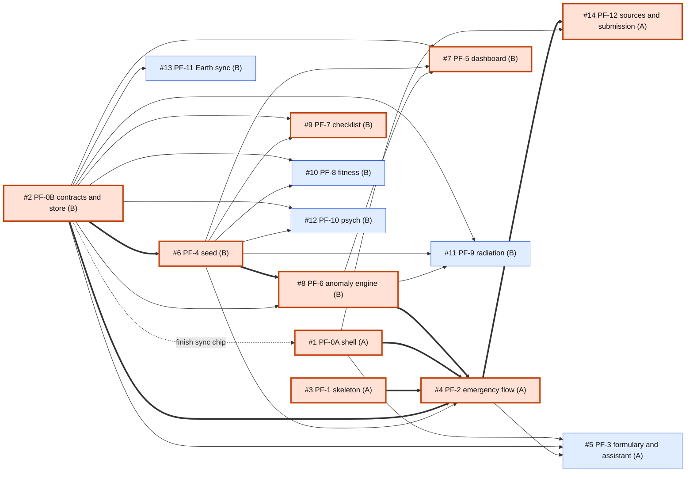

# Pulseframe build plan, issue rewrites, and kickoff

Written Saturday, November 14, 2026. The deadline is Sunday, November 15, 2026, at 11:59 p.m. Asia/Karachi (PKT). That leaves about one and a half working days. Every choice below favors a working demo path over extra modules.

## 1. Plan

### Time reality

- Dev A load: about 16 hours. Dev B load: about 19 hours. Both fit only if must-haves land Saturday night and Sunday morning.
- First complete Submit for Judging: Sunday 18:00 PKT. Final resubmit: Sunday 22:30 PKT. No merges to `main` after 23:00 PKT.
- Phases below are counted in hours from kickoff (T+0), because the start time is not fixed. The Sunday clock times are hard targets.

### Architecture

Single-page Vite, React, and TypeScript app. No backend for the Sunday path. Everything runs in the browser on IndexedDB. Optional serverless functions under `api/` (Vercel) carry the Groq and Whisper calls, and those are stretch.

```
src/
  contracts/        keys.ts, types.ts, index.ts        shared, change only through PF-0B rules
  data/             Dev B. Persistence and pure logic
    db.ts           public barrel. The only data import path for UI modules
    store.ts        IndexedDB store implementation (moved out of db.ts)
    live.ts         subscribe + useLive hook
    mission.ts      mission day helpers, MISSION_DAY_TODAY = 142
    init.ts         initData(): seed, then start sync loop
    seed.ts         7-day simulated mission
    anomaly.ts      z-score engine, explainAlert, rebuildAlerts
    demoBounds.ts   demonstration hard bounds (self-report scales only)
    sync.ts         outbox, checksum, queuePacket, queueEmergencyCase, sync loop
    inventory/      demoIssKit.ts and researcherKit.ts (content owned by Dev A)
  ui/               small shared primitives: Disclaimer, Chip, HazardChip (Dev A), AlertCard, MetricTrend (Dev B)
  modules/
    shell/          Dev A
    skeleton/       Dev A
    emergency/      Dev A
    protocols/      Dev A. Protocol card JSON + zod schema + matcher
    assistant/      Dev A
    sources/        Dev A
    dashboard/      Dev B
    checklist/      Dev B
    fitness/        Dev B
    radiation/      Dev B
    psych/          Dev B
    sync/           Dev B
api/                stretch only: assistant.ts (Groq), transcribe.ts (Whisper)
```

Routes (`src/App.tsx`):

| Route | Module | Figma frame |
| --- | --- | --- |
| `/` | dashboard | [05 (5:110)](https://www.figma.com/design/Rv5ffoCJxWrZDF0BnAuYZi?node-id=5-110), alert pattern [10 (7:367)](https://www.figma.com/design/Rv5ffoCJxWrZDF0BnAuYZi?node-id=7-367) |
| `/emergency` | emergency, embeds skeleton | [02A (2:20)](https://www.figma.com/design/Rv5ffoCJxWrZDF0BnAuYZi?node-id=2-20), [02B (3:38)](https://www.figma.com/design/Rv5ffoCJxWrZDF0BnAuYZi?node-id=3-38), [02C (3:255)](https://www.figma.com/design/Rv5ffoCJxWrZDF0BnAuYZi?node-id=3-255) |
| `/assistant` | assistant | [03 (4:74)](https://www.figma.com/design/Rv5ffoCJxWrZDF0BnAuYZi?node-id=4-74) |
| `/checklist` | checklist | [04 (4:212)](https://www.figma.com/design/Rv5ffoCJxWrZDF0BnAuYZi?node-id=4-212) |
| `/fitness` | fitness | [06 (5:319)](https://www.figma.com/design/Rv5ffoCJxWrZDF0BnAuYZi?node-id=5-319) |
| `/radiation` | radiation | [07 (6:146)](https://www.figma.com/design/Rv5ffoCJxWrZDF0BnAuYZi?node-id=6-146) |
| `/psych` | psych | [08 (6:296)](https://www.figma.com/design/Rv5ffoCJxWrZDF0BnAuYZi?node-id=6-296) |
| `/sync` | sync, outbox plus Ground Portal | [09 (7:182)](https://www.figma.com/design/Rv5ffoCJxWrZDF0BnAuYZi?node-id=7-182) |
| `/sources` | sources | none |
| `*` | shell NotFound | none |

Shell: [01 (1:11)](https://www.figma.com/design/Rv5ffoCJxWrZDF0BnAuYZi?node-id=1-11). Nav parts: [Components (1:2)](https://www.figma.com/design/Rv5ffoCJxWrZDF0BnAuYZi?node-id=1-2).

How state is shared:

- IndexedDB is the single source of truth. Every write goes through `store` in `src/data/store.ts`.
- Every store write calls `notify()`. `useLive(query, deps)` in `src/data/live.ts` re-runs its query on each notify. This is how a test result typed in Emergency shows up on the Dashboard, and how a queued packet shows up in the shell sync chip and on `/sync`, without a global React store.
- Zustand holds UI settings only: sync delay, link up or down (PF-11), and assistant mode (PF-3). Persist them with zustand `persist` to localStorage.
- `caseId` ties emergency data together. Emergency test results are Measurements with `source: "emergency-test"` and `caseId`. The anomaly engine scores them against the personal baseline but leaves them out of the baseline window. `queueEmergencyCase(caseId)` collects everything with that `caseId` into one emergency packet.
- `initData()` runs once in `src/main.tsx` before render: seed if needed, then start the sync loop.

AI layer (your Groq and Whisper choice):

- The assistant is an interface layer, not the source of truth. Protocol cards in `src/modules/protocols/cards/*.json` and the inventory in `src/data/inventory/` are the source of truth.
- `AssistantProvider` interface in `src/modules/assistant/providers.ts`. Two providers: `offlineProvider` (Sunday must, rule-based on protocol cards) and `liveProvider` (stretch PF-S2, calls `/api/assistant`).
- Groq runs only server-side in `api/assistant.ts`. The Groq key must never be a `VITE_` variable, because Vite inlines `VITE_` variables into the public bundle. Server env vars: `GROQ_API_KEY`, `GROQ_MODEL`. The function asks Groq for JSON output and returns it raw. The client still runs `validateRecommendation()` against the inventory, so unknown item ids are rejected in code even if the model invents them.
- Whisper dictation is stretch PF-S6. `api/transcribe.ts` takes a short audio blob from `MediaRecorder`, forwards it to the OpenAI transcription endpoint with `OPENAI_API_KEY` and model `whisper-1`, and returns text into the narrative or command box. The user reviews the text before it is used.
- Voice and the under-18 rule: Umer is 17. Umer must not record or send his own voice to Whisper, in testing or in the demo. Only a teammate who is 18 or older may test dictation. The demo video uses typed input and no voiceover. Check whether Groq also hosts a Whisper model on the same key before adding a second provider. I did not verify that.
- If no key or no network: the app falls back to `offlineProvider` and shows "Offline mode: protocol cards". This keeps the CONTRIBUTING rule that the app runs with no key set.

Deploy: Vercel static build with a SPA rewrite (`vercel.json`), so deep links like `/emergency` load. The Space Apps form needs links that open with no login. The repo is private today, so the "final project link" must be either the deployed app URL or the repo made public before submission. Decide this Sunday morning (see assumptions).

### Data model

Keep every existing type. Land these changes in PF-0B (issue 2) before feature work. Only changed or new shapes are shown.

```ts
// src/contracts/keys.ts additions
export const MEASUREMENT_KEYS = [
  /* existing 12 keys */ "radiationRate",
] as const;
// UNITS.radiationRate = "µGy/h"

export const KEY_LABELS: Record<MeasurementKey, string> = {
  heartRate: "Heart rate", systolicBP: "Systolic BP", diastolicBP: "Diastolic BP",
  temperatureC: "Body temperature", bloodGlucose: "Blood glucose", sleepHours: "Sleep",
  moodScore: "Mood", stressScore: "Stress", teamStrain: "Team strain",
  sleepQuality: "Sleep quality", oxygenSat: "Oxygen saturation", painScore: "Pain",
  radiationRate: "Radiation dose rate",
};

export const HRP_HAZARDS = [
  { id: "radiation", label: "Space radiation" },
  { id: "isolation", label: "Isolation and confinement" },
  { id: "distance", label: "Distance from Earth" },
  { id: "gravity", label: "Gravity fields" },
  { id: "environment", label: "Hostile or closed environments" },
] as const;
export type HazardId = (typeof HRP_HAZARDS)[number]["id"];
export const HRP_HAZARDS_URL = "https://www.nasa.gov/hrp/hazards/";
```

```ts
// src/contracts/types.ts changes
export type EmergencyStage =
  | "intake" | "pinpoint" | "current-info" | "differential"
  | "tests" | "immediate" | "kit" | "handoff" | "monitoring";

export interface EmergencyCase {
  /* existing fields */
  stage: EmergencyStage;          // resume the flow after reload
  protocolId?: string;            // matched protocol card id
  packetId?: string;              // emergency SyncPacket id after handoff
  closedAt?: IsoDateTime;
}

export interface ProtocolStep {
  /* existing fields */
  order: number;
  completedAt?: IsoDateTime;
  measurementId?: string;         // Measurement written from this test
}

export interface InventoryItem {
  /* existing fields, except: */
  quantityOnBoard: number | null; // null when the source does not state it
  provenance: "historical-demo-subset" | "researcher-list";
  sourcePage?: string;            // page number in the source PDF
}

export interface Alert {
  /* existing fields */
  measurementId?: string;
  caseId?: string;
  windowDays?: number;
  sampleCount?: number;
}

export interface Workout {
  /* existing fields */
  plannedMinutes?: number;        // demonstration plan, not a NASA prescription
}

export interface SyncPacket {
  /* existing fields */
  crewId: CrewId;
  kind: "routine-summary" | "emergency-case";
}

export interface GroundReceipt {
  id: string;                     // same as SyncPacket.id, so retries dedupe
  receivedAt: IsoDateTime;
  checksumOk: boolean;
  priority: PacketPriority;
  kind: SyncPacket["kind"];
  payloadJson: string;
}
```

IndexedDB: bump `DB_VERSION` to 2. Add object stores `steps`, `recommendations`, `medAdmins`, `groundInbox`, and `meta` (all `keyPath: "id"`). The existing upgrade loop already skips stores that exist, so add the names to the list.

### Store API

`PulseframeStore` grows from 8 to 38 methods. The 8 existing methods keep their signatures. `addMeasurement` keeps working and now calls `recordMeasurement` internally.

```ts
export interface PulseframeStore {
  // existing
  getCrew(): Promise<CrewProfile>;
  listMeasurements(crewId: CrewId, from?: IsoDateTime, to?: IsoDateTime): Promise<Measurement[]>;
  addMeasurement(m: Omit<Measurement, "id">): Promise<Measurement>;
  listAlerts(crewId: CrewId): Promise<Alert[]>;
  getBaselines(crewId: CrewId): Promise<Baseline[]>;
  listInventory(): Promise<InventoryItem[]>;
  saveCase(c: EmergencyCase): Promise<EmergencyCase>;
  getOpenCase(crewId: CrewId): Promise<EmergencyCase | undefined>;

  // new: measurements and alerts
  recordMeasurement(m: Omit<Measurement, "id">): Promise<{ measurement: Measurement; alert?: Alert }>;
  saveAlert(a: Alert): Promise<Alert>;
  ackAlert(id: string, at?: IsoDateTime): Promise<Alert | undefined>;
  clearAlerts(crewId: CrewId): Promise<void>;
  saveBaselines(b: Baseline[]): Promise<void>;

  // new: inventory, cases, steps, recommendations, meds
  putInventory(items: InventoryItem[]): Promise<void>;
  getCase(id: string): Promise<EmergencyCase | undefined>;
  listCases(crewId: CrewId): Promise<EmergencyCase[]>;
  listSteps(caseId: string): Promise<ProtocolStep[]>;
  saveSteps(steps: ProtocolStep[]): Promise<void>;
  saveRecommendation(r: Recommendation): Promise<Recommendation>;
  listRecommendations(caseId: string): Promise<Recommendation[]>;
  recordMedicationAdmin(a: Omit<MedicationAdmin, "id">): Promise<MedicationAdmin>;
  listMedicationAdmins(crewId: CrewId, from?: IsoDateTime): Promise<MedicationAdmin[]>;

  // new: daily modules
  listChecklist(missionDay: string): Promise<ChecklistItem[]>;
  saveChecklistItem(i: ChecklistItem): Promise<ChecklistItem>;
  listWorkouts(crewId: CrewId, from?: IsoDateTime): Promise<Workout[]>;
  saveWorkout(w: Workout): Promise<Workout>;
  listRadiation(crewId: CrewId, from?: IsoDateTime): Promise<RadiationReading[]>;
  addRadiation(r: Omit<RadiationReading, "id">): Promise<RadiationReading>;
  listPsych(crewId: CrewId, from?: IsoDateTime): Promise<PsychCheck[]>;
  addPsych(p: Omit<PsychCheck, "id">): Promise<PsychCheck>;

  // new: sync
  listPackets(): Promise<SyncPacket[]>;
  savePacket(p: SyncPacket): Promise<SyncPacket>;
  listGroundReceipts(): Promise<GroundReceipt[]>;
  saveGroundReceipt(r: GroundReceipt): Promise<void>;

  // new: lifecycle
  getMeta(key: string): Promise<unknown>;
  setMeta(key: string, value: unknown): Promise<void>;
  resetAll(): Promise<void>;
  subscribe(listener: () => void): () => void;
}
```

Other exports from `src/data/db.ts` (the barrel): `store`, `SIM_CREW`, `useLive`, `MISSION_DAY_TODAY`, `missionDayOf`, `missionDayStart`, `missionDayLabel`, `queuePacket`, `queueEmergencyCase`, `resetDemoData` (PF-4), `explainAlert` and `rollingBaselineSeries` (PF-6), `useSyncSettings` (PF-11).

### Module boundaries

| Folder | Owner | May import | Must not |
| --- | --- | --- | --- |
| `src/contracts` | both, via PF-0B rules | nothing in `src` | import React or data code |
| `src/data/*` | Dev B (content of `src/data/inventory/*` is Dev A) | `src/contracts`, `idb`, `zod`, `zustand`, React only in `live.ts` | import from `src/modules` or `src/ui` |
| `src/ui/*` | file owner as listed above | `src/contracts`, `src/data/db` | import from `src/modules` |
| `src/modules/<x>` | owner of x | `src/contracts`, `src/data/db`, `src/ui`, own folder | import another owner's module folder; import `idb` or `src/data/store.ts` directly |
| Dev A modules among themselves | Dev A | emergency may import skeleton, protocols, assistant | |
| Dev B modules among themselves | Dev B | dashboard may import from checklist, fitness, radiation, psych, sync | |
| `api/*` | Dev A (stretch) | Node built-ins, `fetch` | be imported by `src` |

Internal files in `src/data` import from `./store`, never from `./db`. This avoids a circular import, because `db.ts` re-exports `sync.ts` and `sync.ts` needs `store`.

### Shared contracts

Freeze list. Both devs code against these. A change after PF-0B merges needs a separate PR and a note on the issue thread.

1. Record shapes: all types in `src/contracts/types.ts` with the PF-0B changes above.
2. Measurement keys: the 12 existing keys plus `radiationRate`. Units from `UNITS`. Labels from `KEY_LABELS`.
3. Skeleton regions: `head, chest, abdomen, spine, leftArm, rightArm, leftLeg, rightLeg, skin`. `SkeletonView` reports one of these on click. No new regions for Sunday.
4. Store API: the `PulseframeStore` interface above.
5. Packet helper: `queueEmergencyCase(caseId: string): Promise<SyncPacket>` and `queuePacket(input)`. Dev A calls only `queueEmergencyCase`.
6. Mission day: `MISSION_DAY_TODAY = 142`. Checklist `missionDay` is the string `"142"`.
7. Simulated crew: `crew-sim-01`. Header text shows `displayName` plus "(simulated)".
8. Hazard ids from `HRP_HAZARDS`. Each page shows one `HazardChip`.

Contract changes both devs must land before feature work: only PF-0B (issue 2). Dev A reviews that PR within 30 minutes.

### Anomaly rules (PF-6)

- Window: same crew, same key, the 7 days before the reading. Exclude rows with a `caseId`. Exclude the reading itself.
- Burn-in: at least 3 samples across at least 3 distinct days. Before burn-in, skip the z-score and use hard bounds only.
- μ is the mean. σ is the sample standard deviation (n minus 1).
- Near-zero σ: `σ < max(1e-6, 0.001 * |μ|)`. Skip the z-score and use hard bounds only.
- z = (x - μ) / σ. Watch when |z| is 2 or more. Act when |z| is 3 or more.
- Hard bounds live in `src/data/demoBounds.ts` and cover only the self-report scales. Each is labeled "Demonstration threshold, not a clinical limit." There are no vital-sign hard bounds until the researcher supplies cited values. Demonstration values: moodScore watch at 2 or below, act at 1. sleepQuality watch at 2 or below, act at 1. stressScore watch at 4 or above, act at 5. teamStrain watch at 4 or above, act at 5. painScore watch at 4 or above, act at 7.
- Dedupe: one unacknowledged alert per key per mission day. A higher severity replaces a lower one.
- Each alert stores μ, σ, x, z, window size, and the measurement id. `explainAlert()` returns plain language that ends with "This compares you with your own recent baseline. It is not a diagnosis."
- The UI never claims NASA validation for this method.

### Seed scenario (PF-4)

Simulated values. These are not reference ranges. Seven mission days, MD 136 to MD 142, with MD 142 equal to today on the device clock.

| Key | 136 | 137 | 138 | 139 | 140 | 141 | 142 |
| --- | --- | --- | --- | --- | --- | --- | --- |
| heartRate (07:00) | 60 | 66 | 62 | 64 | 67 | 61 | 78 |
| systolicBP | 112 | 114 | 111 | 113 | 114 | 112 | 114 |
| diastolicBP | 72 | 74 | 71 | 73 | 74 | 72 | 73 |
| temperatureC | 36.6 | 36.7 | 36.5 | 36.6 | 36.7 | 36.6 | 36.7 |
| bloodGlucose | 92 | 95 | 90 | 94 | 93 | 91 | 94 |
| oxygenSat | 98 | 98 | 97 | 98 | 98 | 98 | 98 |
| sleepHours (06:30) | 7.2 | 7.0 | 7.4 | 5.1 | 4.4 | 6.4 | 6.8 |
| sleepQuality | 4 | 4 | 4 | 2 | 2 | 3 | 4 |
| moodScore (20:00) | 4 | 4 | 4 | 3 | 3 | 4 | 4 |
| stressScore | 2 | 2 | 2 | 3 | 3 | 2 | 2 |
| teamStrain | 2 | 2 | 2 | 2 | 2 | 2 | 2 |
| radiationRate (12:00) | 17.8 | 18.1 | 17.9 | 18.0 | 18.0 | 17.9 | 18.0 |

I ran these rules over this table. The seed produces exactly 4 alerts:

1. sleepHours, MD 139, act, μ 7.20, σ 0.200, z -10.50
2. sleepQuality, MD 139, watch, hard-bound (σ is 0 over 4, 4, 4; value 2)
3. sleepHours, MD 140, watch, μ 6.68, σ 1.063, z -2.14
4. heartRate, MD 142, act, μ 63.33, σ 2.805, z 5.23

In the demo, entering heart rate 96 as an emergency test on MD 142 gives act, μ 65.43, σ 6.106, z 5.01. The window now includes the MD 142 morning reading. The case reading itself is excluded.

The radiation series is simulated and is not ISS data. Its σ is small, so a manual entry of 19.0 gives z 10.69, which is useful for testing.

### NASA data and resources in the product

These are used in the product, not only cited:

1. Public NASA ISS medical kit checklist. A tiny transcribed subset is the only inventory the assistant may recommend from. Code rejects any other item id. It is labeled "Historical demonstration subset, not a current flight kit."
2. NASA HRP five hazards. `HRP_HAZARDS` tags every module (radiation log: Space radiation; psych: Isolation and confinement; sync: Distance from Earth; fitness: Gravity fields; checklist and emergency: Hostile or closed environments). The dashboard groups its tiles by hazard. The Sources page maps each module to its hazard and links to the HRP pages.
3. NASA SRAG Crew Active Dosimeters page. This shapes the radiation log model (`source: "simulatedCAD"`, dose rate plus cumulative) and is linked from that page.
4. NASA exercise countermeasure pages. These shape the fitness tracker categories (resistive and aerobic) and are linked from that page.
5. CSA radiation article and the OCHMO behavioral health brief. These are linked from the radiation and psych pages. The psych page says it is a simple self-report and not WinSCAT.

### Build order

| Phase | Hours | Dev A | Dev B |
| --- | --- | --- | --- |
| 0 | T+0 to T+2 | #1 shell, #3 controlled skeleton API, kit subset transcription for #5 | #2 contracts and store, merged by T+2 |
| 1 | T+2 to T+7 | #3 finish, #4 intake, pinpoint, current info | #6 seed, #8 engine |
| 2 | T+7 to T+11 | #4 differential, tests, immediate steps, handoff | #7 dashboard, #9 checklist |
| Sleep | | at least 5 hours each | |
| 3 | Sunday to 14:00 PKT | #14 sources plus Vercel deploy, #5 assistant offline | #13 sync, #11 radiation |
| 4 | 14:00 to 18:00 PKT | must-have freeze at 14:00. Rehearse the demo path, record a video of 30 seconds or less, fill the form. First Submit for Judging by 18:00 | bug fixes on the demo path only |
| 5 | 18:00 to 22:30 PKT | #5 polish. PF-S1 or PF-S2 only if everything is green | #10 fitness, #12 psych |
| 6 | 22:30 PKT | final resubmit, check every link logged out | freeze |

If Dev B is behind at Sunday 12:00 PKT, cut in this order: stretch, live LLM, #12 psych, #10 fitness. Never cut #4, #7, or #8.

### Sunday demo path

Use this script for the video. Typed input only, captions instead of a voiceover, and no faces.

1. `/` dashboard: the week MD 136 to MD 142, sleep slump alerts, and the MD 142 heart rate act alert with its z formula.
2. Click Emergency in the nav. Type "Chest tightness after resistive exercise session". Click the chest on the skeleton.
3. Current info: heart rate 78 against μ 63.3. The open alert is listed.
4. Working differential, labeled "not definitive". Test step: enter heart rate 96. An inline Act alert appears.
5. Immediate steps from the protocol card. Kit step: onboard items from the demonstration subset, each with a confirm-before-given dialog.
6. Queue the emergency packet. `/sync` shows it jump the queue and arrive in the Ground Portal after the delay. The case is now in monitoring.

### Recommended stretch issues

Open these only after the first submission. No paste-ready bodies for them here.

- PF-S1 credited, decimated Z-Anatomy or BodyParts3D GLB.
- PF-S2 live LLM: `api/assistant.ts` on Groq, validated against the kit list on the client.
- PF-S3 optional photo or extra test input. No images of anyone under 18.
- PF-S4 second simulated crew member.
- PF-S5 `missing-routine` alerts for undone required checklist items. This needs `Alert.key` to become optional.
- PF-S6 Whisper voice dictation through `api/transcribe.ts`. Only teammates 18 or older may test it.

### Assumptions

- The start time is unknown, so phases are counted in hours. Sunday clock targets are fixed.
- Burn-in of 3 samples over 3 days and the near-zero σ rule are my choices. The source file did not set them.
- Demonstration hard bounds cover only the 1 to 5 and 0 to 10 self-report scales. Vital signs get no hard bound until the researcher supplies a cited value.
- I did not open the NASA medical kit PDF. Dev A transcribes 3 to 5 items from it. Fields the PDF does not state stay empty, and quantity is `null`.
- Protocol card text (differential, test instructions, immediate steps) is demonstration copy with no medications or doses. The researcher should review it.
- I did not inspect the Figma frames beyond their names and the description in the brief.
- Deploy target is Vercel. The repo is private, so either make it public or use the deployed URL as the final project link.
- Ahmed's age is unknown. The default is no voiceover at all.
- I have not checked whether vitest supports Vite 8. PF-6 has a fallback.
- CONTRIBUTING.md says to name branches by issue number, but its example `feature/pf-5-dashboard` uses the PF code. This plan uses the issue number: `feature/pf-7-dashboard` for issue 7.
- Exercise device names and planned minutes are not given in the brief. `device` stays optional, and planned minutes are labeled as a demonstration plan.
- Groq model names change, so the model comes from the `GROQ_MODEL` env var and is not hard-coded.
- Single crew member for Sunday.

## 2. Rewritten issues

### Issue 1

https://github.com/umeraamir09/pulseframe/issues/1

````markdown
## Summary
Every route renders inside one shell. The shell has a left nav with an always-visible red Emergency control, a header that shows the simulated crew, mission day, and Earth sync status, and a decision-support disclaimer that never scrolls out of reach. Shared UI primitives live in `src/ui/`, and the app deploys to a public URL where deep links work.

## Context
This serves every feature and the judging rule that the tool is decision support only. Follow Figma frame 01 Home / app shell (https://www.figma.com/design/Rv5ffoCJxWrZDF0BnAuYZi?node-id=1-11) and the Nav Item and Nav Item / Active parts in Components (https://www.figma.com/design/Rv5ffoCJxWrZDF0BnAuYZi?node-id=1-2). Low-fi is fine. Spec: https://cursor.com/canvas/store-c803f290-9f41-41b1-9e9b-993d1c558d72/0bf5085b-2464-43a3-b740-9e63ab7c34df. Breakdown: https://cursor.com/canvas/store-c803f290-9f41-41b1-9e9b-993d1c558d72/048a95a2-2fd5-4f5c-b578-a96c7264ea83. Full plan: `docs/planning/pulseframe-plan.md` (on branch `claude/clever-feynman-skwgd6` until merged).

## Scope in
- Nav order: Emergency (red, pinned at top), Dashboard, Checklist, Fitness, Radiation, Psychology, Assistant, Ground sync, Sources.
- Header: crew `displayName` + "(simulated)", "MD 142", sync chip.
- `Disclaimer` component with `banner` and `emergency` variants.
- `Chip` (neutral, watch, act) and `HazardChip` primitives.
- NotFound route.
- `vercel.json` SPA rewrite.
- Remove unused Vite marketing assets in `src/assets/` (`hero.png`, `react.svg`, `vite.svg`) so no likeness of anyone under 18 ships.

## Scope out
- Page content for any module.
- Pixel-perfect styling, dark or light theme switch.
- Sync loop logic (issue 13).

## Implementation notes
1. Create `src/ui/Disclaimer.tsx`: `export function Disclaimer({ variant = "banner" }: { variant?: "banner" | "emergency" })`. Banner text stays as it is in `src/modules/shell/AppShell.tsx` today. Emergency text: "Decision support only. This is not a diagnosis. Contact the flight surgeon. Simulated crew data." Use `role="note"`.
2. Create `src/ui/Chip.tsx`: `Chip({ tone: "neutral" | "watch" | "act", children })`. Add `.chip`, `.chip-watch` (amber), and `.chip-act` (red) to `src/index.css`.
3. Create `src/ui/HazardChip.tsx`: `HazardChip({ id }: { id: HazardId })`. It reads its label from `HRP_HAZARDS` and links to `HRP_HAZARDS_URL`. This needs issue 2. Until then, use a local copy of the five labels with a `TODO(#2)` comment.
4. Edit `src/modules/shell/AppShell.tsx`:
   - Move Emergency to the top of `LINKS` and give it class `nav-emergency`.
   - Add a `<header className="topbar">` with crew name, `missionDayLabel(MISSION_DAY_TODAY)`, and `<SyncChip />`.
   - Replace the inline disclaimer div with `<Disclaimer />`. Make `.disclaimer` `position: sticky; top: 0; z-index: 10`.
5. Create `src/modules/shell/SyncChip.tsx`. It calls `useLive(() => store.listPackets(), [])` and shows "Earth sync: N queued" or "Earth sync: all sent". Before issue 2 merges, render "Earth sync: idle".
6. Create `src/modules/shell/NotFound.tsx` and add `<Route path="*" element={<NotFound />} />` in `src/App.tsx`.
7. Add `vercel.json` at the repo root: `{ "rewrites": [{ "source": "/((?!api/).*)", "destination": "/index.html" }] }`.
8. Set `<title>Pulseframe</title>` in `index.html`.
9. Delete the unused files in `src/assets/` after confirming with `grep -rn "assets/" src` that nothing imports them.
10. Import data only from `src/data/db` and types only from `src/contracts`.

## Acceptance criteria
- [ ] `npm run build` and `npm run lint` pass.
- [ ] All 9 routes render with the nav visible, and Emergency is first and red.
- [ ] The disclaimer is visible at the top of the viewport on every route after scrolling to the bottom.
- [ ] The header shows "Simulated Crew Member A (simulated)" and "MD 142".
- [ ] `/does-not-exist` shows the NotFound page inside the shell.
- [ ] After issue 2 merges: running `pf.queuePacket(...)` from the dev console changes the sync chip count without a reload.
- [ ] On the Vercel preview, a hard refresh on `/emergency` loads the page, not a 404.
- [ ] At 390 px width the nav stacks above the content and nothing scrolls sideways.
- [ ] `ls src/assets` shows no unused Vite marketing images, and the build output has no photo of a person.

## Test notes
Run `npm run dev` and click every nav item. Scroll a long page and confirm the disclaimer stays in view. Shrink the window to phone width in DevTools. For the Sunday demo, the Emergency control must be visible on the dashboard without scrolling.

## Blocked by
#2 (to finish the sync chip and `HazardChip` only. Start without it.)

## Blocks
#4, #5, #14

## Owner
Dev A, Umer, umeraamir09

## Labels
must-have, dev-a

## Estimate
1.5 hours
````

### Issue 2

https://github.com/umeraamir09/pulseframe/issues/2

````markdown
## Summary
The shared contracts and the full IndexedDB store surface are merged to `main`, so both devs can build features without touching `idb`. Every type change, the store API, change notifications with `useLive`, mission day helpers, the inventory slot, and a minimal `queueEmergencyCase` are in place. Feature issues only fill in behavior behind these signatures.

## Context
This is the one contract PR both devs depend on. It serves all nine features. There is no Figma frame. The full type and API listing is in the planning doc, `docs/planning/pulseframe-plan.md` (on branch `claude/clever-feynman-skwgd6` until merged), sections "Data model" and "Store API".

## Scope in
- Type changes in `src/contracts/types.ts` and additions in `src/contracts/keys.ts`.
- Move the store into `src/data/store.ts`. `src/data/db.ts` becomes the barrel.
- DB version 2 with 5 new object stores.
- All 38 store methods, implemented simply with `getAll` and filtering.
- `src/data/live.ts` with `subscribe`/`notify` and `useLive`.
- `src/data/mission.ts`.
- `src/data/sync.ts` with `sha256Hex`, `queuePacket`, `queueEmergencyCase` (queue only, no loop).
- `src/data/init.ts` with `initData()` stubs for seed and loop.
- Inventory slot files with empty typed arrays.
- A dev-only `window.pf` console handle.

## Scope out
- Seed contents (issue 6).
- Anomaly scoring inside `recordMeasurement` (issue 8). In this issue it returns `{ measurement }` only.
- Sync loop, delay, retry, Ground Portal (issue 13).
- Any UI.

## Implementation notes
1. `src/contracts/keys.ts`: add `"radiationRate"` to `MEASUREMENT_KEYS`, `radiationRate: "µGy/h"` to `UNITS`, and add `KEY_LABELS`, `HRP_HAZARDS`, `HazardId`, `HRP_HAZARDS_URL`, exactly as shown in the plan.
2. `src/contracts/types.ts`: add `EmergencyStage` and `GroundReceipt`. Extend `EmergencyCase` (`stage`, `protocolId?`, `packetId?`, `closedAt?`), `ProtocolStep` (`order`, `completedAt?`, `measurementId?`), `InventoryItem` (`quantityOnBoard: number | null`, `provenance`, `sourcePage?`), `Alert` (`measurementId?`, `caseId?`, `windowDays?`, `sampleCount?`), `Workout` (`plannedMinutes?`), and `SyncPacket` (`crewId`, `kind`). Replace `PulseframeStore` with the 38-method interface.
3. Move everything in `src/data/db.ts` into `src/data/store.ts`. Set `DB_VERSION = 2` and add `"steps", "recommendations", "medAdmins", "groundInbox", "meta"` to the upgrade list.
4. In `store.ts`, cache the connection: `let dbp: Promise<IDBPDatabase> | undefined; const connect = () => (dbp ??= openDB(...))`.
5. `src/data/live.ts`:
   - `const listeners = new Set<() => void>()`
   - `export function notify()`
   - `export function subscribeStore(fn)`
   - `export function useLive<T>(query: () => Promise<T>, deps: unknown[]): { data: T | undefined; loading: boolean; error?: Error }`. It runs the query on mount, on deps change, and on every notify.
   - Every write method in `store.ts` calls `notify()` after its `put` or `delete`. `store.subscribe` delegates to `subscribeStore`.
6. Method rules:
   - `listX(crewId, from?)` filters by `crewId` and `at` or `takenAt >= from`, sorted ascending by time.
   - `ackAlert` sets `ackedAt` to `at ?? new Date().toISOString()`.
   - `listChecklist(missionDay)` filters by `missionDay`.
   - `listSteps(caseId)` is sorted by `order`.
   - `resetAll()` clears every object store and calls `notify()` once.
   - `getMeta`/`setMeta` store `{ id: key, value }` in `meta`.
7. `src/data/mission.ts`:
   - `export const MISSION_DAY_TODAY = 142`
   - `export const SEED_DAYS = 7`
   - `missionDayStart(md: number): Date` returns local midnight today minus `(142 - md)` days
   - `missionDayOf(iso: string): number`
   - `missionDayLabel(md: number): string` returns `"MD 142"`
8. `src/data/sync.ts`:
   - `sha256Hex(text)` via `crypto.subtle.digest("SHA-256", ...)`.
   - `queuePacket({ priority, kind, destination, payload })` creates a `SyncPacket` with `id: id("pkt")`, `payloadJson: JSON.stringify(payload)`, the checksum, `status: "queued"`, `retryCount: 0`, and `crewId: SIM_CREW.id`.
   - `queueEmergencyCase(caseId)` loads the case, `listSteps`, measurements with that `caseId`, alerts with that `caseId` or opened since `startedAt`, `listRecommendations`, and med admins since `startedAt`. It calls `queuePacket({ priority: "emergency", kind: "emergency-case", destination: "earth-surgeon", payload })` and returns the packet.
9. `src/data/init.ts`: `export async function initData() { await seedIfNeeded(); startSyncLoop(); }`. Import `seedIfNeeded` from `./seed`, which is an exported no-op until issue 6. `startSyncLoop` comes from `./sync` and is a no-op until issue 13.
10. `src/data/inventory/demoIssKit.ts`: `export const DEMO_ISS_KIT_SUBSET: InventoryItem[] = []` with a header comment saying it is transcribed only from the public NASA PDF, it is a historical demonstration subset, and Dev A fills it. `src/data/inventory/researcherKit.ts`: `export const RESEARCHER_KIT: InventoryItem[] = []` with a comment saying the researcher list goes here, nothing is invented, and when this list is non-empty it replaces the demo subset. `src/data/inventory/index.ts`: `export const ACTIVE_INVENTORY = RESEARCHER_KIT.length ? RESEARCHER_KIT : DEMO_ISS_KIT_SUBSET`.
11. `src/data/db.ts` becomes `export { store, SIM_CREW, connect, id } from "./store"; export * from "./live"; export * from "./mission"; export { queuePacket, queueEmergencyCase } from "./sync"; export { initData } from "./init";`. Files inside `src/data` import from `./store`, never `./db`.
12. `src/main.tsx`: call `void initData();` before `createRoot`. Add `if (import.meta.env.DEV) Object.assign(window, { pf: { store, queuePacket, queueEmergencyCase } })`.
13. Post the merged signatures as a comment on this issue and tag Dev A.

## Acceptance criteria
- [ ] `npm run build` and `npm run lint` pass with no `any` in `src/data/store.ts`.
- [ ] `grep -rn "from \"idb\"" src/modules src/ui` returns nothing.
- [ ] In DevTools, Application, IndexedDB shows database `pulseframe` at version 2 with 15 object stores.
- [ ] In the dev console, `await pf.store.recordMeasurement({crewId:"crew-sim-01",key:"heartRate",value:70,unit:"bpm",source:"manual",takenAt:new Date().toISOString()})` returns `{ measurement }` with an `m-` id.
- [ ] `await pf.queuePacket({priority:"routine",kind:"routine-summary",destination:"earth-surgeon",payload:{a:1}})` returns a packet with status `queued` and a 64-character hex checksum.
- [ ] A component that uses `useLive(() => store.listPackets(), [])` re-renders after that console call without a reload.
- [ ] `await pf.store.resetAll()` empties every object store.
- [ ] Opening the app with an old version 1 database upgrades without errors.

## Test notes
Use the dev console handle for every check. Delete the database in DevTools and reload to test a fresh install. There is nothing to demo directly. This is the base for the whole Sunday path.

## Blocked by
None

## Blocks
#1, #4, #5, #6, #7, #8, #9, #10, #11, #12, #13

## Owner
Dev B, Ahmed, AhmedYasirJwd

## Labels
must-have, dev-b

## Estimate
2.5 hours
````

### Issue 3

https://github.com/umeraamir09/pulseframe/issues/3

````markdown
## Summary
`SkeletonView` is a controlled React Three Fiber component. It shows a body made of placeholder region meshes, highlights selected regions, shows hover feedback, reports a `SkeletonRegionId` on click, supports multi-select, and can mark regions that have an open alert. The emergency page embeds it.

## Context
This serves feature 1 (pinpoint the problem on a 3D skeleton). Follow Figma frame 02A Emergency intake, 3D skeleton, current info (https://www.figma.com/design/Rv5ffoCJxWrZDF0BnAuYZi?node-id=2-20). The Sunday path uses the existing placeholder boxes. A credited GLB is stretch PF-S1.

## Scope in
- Controlled props: `selected`, `onToggle`, `flagged`, `readOnly`.
- Hover color and cursor change.
- A visible label for every selected region.
- A button list fallback under the canvas for each region, including `skin`, which has no mesh.
- Camera presets: front and back.

## Scope out
- GLB loading, Z-Anatomy or BodyParts3D models (PF-S1).
- Named bones.
- Photo input.

## Implementation notes
1. In `src/modules/skeleton/SkeletonView.tsx`, change the props to `{ selected: SkeletonRegionId[]; onToggle?: (id: SkeletonRegionId) => void; flagged?: SkeletonRegionId[]; readOnly?: boolean }`. Remove the internal `useState` for selection. Keep `LAYOUT`.
2. In `RegionBox`, add `onPointerOver` and `onPointerOut` to set a hover state and `document.body.style.cursor`. Colors: base `#d7c4a3`, hover `#e8d9bd`, selected `#ff6b4a`, flagged and not selected `#f2b84b`. Skip the handlers when `readOnly`.
3. Render one `<Html>` label per selected region at `[x, y + h / 2 + 0.08, z]`, using `REGION_LABELS`.
4. Create `src/modules/skeleton/regions.ts` with `export const REGION_LABELS: Record<SkeletonRegionId, string>` ("Head", "Chest", "Abdomen", "Spine", "Left arm", "Right arm", "Left leg", "Right leg", "Skin (whole body)").
5. Under the canvas, render a `<div className="region-buttons">` with one toggle `<button aria-pressed>` per `SKELETON_REGIONS` entry. This gives keyboard access and covers `skin`.
6. Add "Front" and "Back" buttons that set the camera with `OrbitControls` `ref` and `.object.position.set(...)`. Front is `[0, 1.1, 2.6]` and back is `[0, 1.1, -2.6]`, both looking at `[0, 1, 0]`.
7. Create `src/modules/skeleton/SkeletonDemo.tsx`, a wrapper that holds local state, so the component still works standalone until issue 4 lands.
8. Update the footer note to "Placeholder regions. A credited anatomy model is planned."

## Acceptance criteria
- [ ] `npm run build` passes.
- [ ] Clicking the chest box calls `onToggle("chest")` once. The `console.log` in `SkeletonDemo` shows it.
- [ ] Clicking two regions selects both. Both turn `#ff6b4a` and both show labels.
- [ ] Clicking a selected region again deselects it.
- [ ] Hovering a region changes its color and the cursor becomes a pointer.
- [ ] The "Skin (whole body)" button toggles `skin` in the selection.
- [ ] Passing `flagged={["chest"]}` colors the chest amber when it is not selected.
- [ ] With `readOnly`, clicks do nothing.
- [ ] Tab reaches every region button, and Space toggles it.

## Test notes
Mount `SkeletonDemo` on `/emergency` until issue 4 replaces it. Rotate with the mouse, use Front and Back, and click every region. For the Sunday demo, the chest must be clickable within 2 seconds of the page loading.

## Blocked by
None

## Blocks
#4

## Owner
Dev A, Umer, umeraamir09

## Labels
feature, must-have, dev-a

## Estimate
2.5 hours
````

### Issue 4

https://github.com/umeraamir09/pulseframe/issues/4

````markdown
## Summary
A crew member opens Emergency and moves through one persisted flow: situation, pinpoint on the skeleton, current info check, working differential, guided tests that write results back as measurements and raise baseline alerts, immediate steps, onboard kit suggestions, and handoff. Handoff queues a high-priority Earth packet and leaves the case in monitoring. The scripted chest tightness case runs start to finish.

## Context
This serves feature 1 and the Sunday demo path. Follow Figma 02A (https://www.figma.com/design/Rv5ffoCJxWrZDF0BnAuYZi?node-id=2-20), 02B Diagnosis and test steps (https://www.figma.com/design/Rv5ffoCJxWrZDF0BnAuYZi?node-id=3-38), and 02C Immediate actions and handoff (https://www.figma.com/design/Rv5ffoCJxWrZDF0BnAuYZi?node-id=3-255). The demo case is chest tightness after a resistive exercise session, with heart rate above the personal baseline. Do not dramatize a death case.

## Scope in
- A stage machine using `EmergencyStage`, persisted on the case so reload resumes.
- Protocol card format, a zod schema, a matcher, and two cards: `chest-tightness-post-exercise` and `general-fallback`.
- Writing test results through `store.recordMeasurement` with `caseId`.
- Inline `AlertCard` when a result raises an alert.
- Handoff through `queueEmergencyCase`.
- Monitoring banner and a Close case button.
- `Disclaimer variant="emergency"` on every stage.

## Scope out
- The assistant command box and LLM (issue 5). The kit stage uses a simple fallback until issue 5 merges.
- Sync delivery and the Ground Portal (issue 13).
- Photo or voice input (stretch).
- Any medication dose text.

## Implementation notes
1. Change `src/App.tsx` so `/emergency` renders `<EmergencyPage />` only. Delete `EmergencyWithSkeleton`. `EmergencyPage` owns the `.split` layout and renders `SkeletonView` on the right.
2. Create `src/modules/protocols/schema.ts`:
   - `ProtocolCardSchema` (zod) with `id`, `title`, `regionIds: SkeletonRegionId[]`, `keywords: string[]`, `differential: { label: string; note: string }[]`, `tests: { title: string; instruction: string; inputKey?: MeasurementKey }[]`, `immediateSteps: { title: string; instruction: string }[]`, `candidateItemIds: string[]`, `cautions: string`, and `sourceNote: string`.
   - `export type ProtocolCard = z.infer<typeof ProtocolCardSchema>`.
3. Create `src/modules/protocols/cards/chest-tightness-post-exercise.json`. Every string is demonstration copy with no medications or doses. Set `sourceNote` to "Demonstration protocol written by the team for a hackathon prototype. Pending researcher review. Not a NASA protocol."
   - `regionIds: ["chest"]`, keywords `["chest", "tight", "pressure", "exercise", "resistive"]`.
   - Differential: "Chest wall muscle strain after resistive exercise", "Cardiac cause. Cannot be ruled out onboard. Needs flight surgeon review", "Stress or anxiety response".
   - Tests: heart rate (`heartRate`), systolic and diastolic BP (`systolicBP`, `diastolicBP`), oxygen saturation (`oxygenSat`), body temperature (`temperatureC`), pain 0 to 10 (`painScore`). Each test has a plain instruction on how to take the reading with the onboard monitor while resting.
   - Immediate steps: "Stop exercise and rest in a restrained position", "Tell a crewmate and keep them nearby", "Do not resume exercise until the flight surgeon clears it", "Re-measure heart rate and blood pressure and enter the results", "Send the case to the flight surgeon".
   - `candidateItemIds: []` until Dev A confirms matching items from the PDF comments or the researcher list.
4. Create `src/modules/protocols/cards/general-fallback.json` with the same tests and the generic steps.
5. Create `src/modules/protocols/index.ts`. It imports both JSON files, parses them with `ProtocolCardSchema.parse` at module load (throw in dev), and exports `PROTOCOL_CARDS` and `matchProtocol(narrative: string, regionIds: SkeletonRegionId[]): ProtocolCard`. The score is region overlap times 2 plus keyword hits. It returns `general-fallback` when the score is 0.
6. Create `src/modules/emergency/useEmergencyCase.ts`. It loads `store.getOpenCase(SIM_CREW.id)` with `useLive` and exposes `startCase(narrative)`, `setRegions`, `advance(stage)`, `completeStep`, and `closeCase`. Each action calls `store.saveCase` or `store.saveSteps`. When the case reaches `differential`, call `matchProtocol` once, save `protocolId`, and create `ProtocolStep` rows (`kind: "test"` for tests, `"action"` for immediate steps, with `order`).
7. Create stage components in `src/modules/emergency/stages/`:
   - `IntakeStage.tsx`: textarea and a "Start case" button. Disabled when empty.
   - `PinpointStage.tsx`: instructions to click the skeleton, the selected list, and a pain 0 to 10 input that records `painScore` with `caseId`.
   - `CurrentInfoStage.tsx`: for each key in `heartRate, systolicBP, diastolicBP, temperatureC, oxygenSat, sleepHours`, the latest value in the last 24 hours, plus μ and σ from `store.getBaselines`, plus open alerts as `AlertCard compact`. On Continue, save `currentInfoSnapshot` as a JSON string of what was shown.
   - `DifferentialStage.tsx`: a heading "Working differential, not a diagnosis", the card's list, and `cautions`.
   - `TestsStage.tsx`: one row per test step with the instruction, a number input with the unit from `UNITS`, and Save. Save calls `store.recordMeasurement({ ..., source: "emergency-test", caseId })`, then `completeStep` with `resultValue` and `measurementId`. If an alert comes back, render `<AlertCard alert={alert} />` inline. Steps without `inputKey` get a Done checkbox.
   - `ImmediateStage.tsx`: action steps as checkboxes. Continue is enabled when all are checked or the user clicks "Skip with reason" and types a reason, which is saved as the step's `instruction` suffix.
   - `KitStage.tsx`: renders `<KitSuggestions caseId card />` from `src/modules/assistant/KitSuggestions.tsx` when issue 5 has merged. Until then it lists `candidateItemIds` resolved through `store.listInventory()`, or the text "No onboard item suggested in the demonstration data. Contact the flight surgeon."
   - `HandoffStage.tsx`: a summary of the narrative, regions, test results, and steps done. The "Send to flight surgeon (high priority)" button calls `queueEmergencyCase(caseId)`, then saves `packetId`, `status: "monitoring"`, and `stage: "monitoring"`.
8. `MonitorBanner.tsx`: when the case is `monitoring`, show "Monitoring. Re-check heart rate and blood pressure and enter them below." with a quick re-test row, the packet status from `useLive(() => store.listPackets())`, and a "Close case" button that sets `closed` and `closedAt`.
9. `EmergencyPage.tsx`:
   - Left side: a stage progress strip, `<Disclaimer variant="emergency" />`, and the current stage.
   - Right side: `<SkeletonView selected={case.regionIds} onToggle={...} flagged={regionsWithOpenAlerts} readOnly={stage !== "pinpoint"} />`. The flag mapping is a small local map: `heartRate`, `systolicBP`, `diastolicBP`, and `oxygenSat` map to `chest`, and `temperatureC` maps to `skin`.
10. Import only from `src/contracts`, `src/data/db`, `src/ui`, `src/modules/skeleton`, `src/modules/protocols`, and `src/modules/assistant`.

## Acceptance criteria
- [ ] `npm run build` and `npm run lint` pass.
- [ ] With the seed loaded, the scripted demo goes from intake to monitoring in under 90 seconds of clicking.
- [ ] Narrative "Chest tightness after resistive exercise session" plus the chest region matches card `chest-tightness-post-exercise`. A narrative "headache" with the head region matches `general-fallback`.
- [ ] Current info shows heart rate 78 bpm with μ about 63.3 and the open heart rate Act alert.
- [ ] Entering heart rate 96 in the tests stage shows an inline Act alert with z about 5.0, and the dashboard lists that alert without a reload.
- [ ] The saved measurement has `source: "emergency-test"` and the case `caseId` (check in DevTools IndexedDB).
- [ ] Reloading the page mid-flow returns to the same stage with the same regions and step results.
- [ ] Handoff creates one `SyncPacket` with `priority: "emergency"` and `kind: "emergency-case"`, and the case shows `status: "monitoring"`.
- [ ] Close case sets `status: "closed"`, and a new Emergency visit starts at intake.
- [ ] The emergency disclaimer is visible on every stage, and the differential heading includes "not a diagnosis".
- [ ] No text in either card JSON names a dose or a drug.

## Test notes
Reset demo data from the dashboard first. Run the six-step demo script from the plan. Then run it again with the "headache" narrative to check the fallback card. Reload during the tests stage to check resume. Record the Sunday demo from this flow.

## Blocked by
#1, #2, #3 (to start). #6, #8 (to finish current info and inline alerts).

## Blocks
#5, #14

## Owner
Dev A, Umer, umeraamir09

## Labels
feature, must-have, dev-a

## Estimate
6 hours
````

### Issue 5

https://github.com/umeraamir09/pulseframe/issues/5

````markdown
## Summary
The Assistant page shows the onboard formulary and a command box. The offline provider suggests items only from the inventory file, based on protocol cards. Code rejects unknown item ids. Every suggestion needs a confirm step before an item is marked given, and the app never writes a dose. A provider interface is ready for a live Groq call (stretch PF-S2), and the app works fully with no key set.

## Context
This serves feature 2 (solve with the meds and resources on board, with AI commands). Follow Figma 03 AI treatment assistant, onboard kit only (https://www.figma.com/design/Rv5ffoCJxWrZDF0BnAuYZi?node-id=4-74). The only allowed inventory source until the researcher list arrives is the public NASA ISS medical kit checklist: https://www.nasa.gov/wp-content/uploads/2015/03/medical_kit_checklist_-_full_release.pdf

## Scope in
- Transcribe 3 to 5 items from that PDF into `src/data/inventory/demoIssKit.ts`, copying comments where they exist.
- A formulary table.
- Commands: `suggest`, `find <text>`, `item <id>`, `alerts`, `help`.
- `validateRecommendation` with zod and an id allowlist.
- `KitSuggestions` component reused by the emergency kit stage.
- A confirm-before-given dialog that writes `MedicationAdmin`.
- The `AssistantProvider` interface, `offlineProvider`, and a `liveProvider` client stub behind `VITE_ASSISTANT_MODE=live`.

## Scope out
- `api/assistant.ts` and the Groq call (PF-S2).
- Whisper dictation (PF-S6).
- Any dosing advice, drug interaction logic, or items not in the inventory file.

## Implementation notes
1. Fill `DEMO_ISS_KIT_SUBSET` in `src/data/inventory/demoIssKit.ts`. Pick items whose PDF comments are short and clear. For each item:
   - `id` is `kit-<pack>-<slug>`.
   - `name`, `pack`, `strength`, `route`, `location`, `sideEffects`, and `comments` are copied from the PDF. Use `""` when the PDF does not state a field.
   - `quantityOnBoard` is the PDF quantity or `null`.
   - `provenance: "historical-demo-subset"`, `sourceUrl` is the PDF URL, and `sourcePage` is the page number.
   - Do not write anything that is not in the PDF. If unsure, leave the item out.
   - Merge this as its own small PR early (`chore: transcribe demo kit subset (#5)`) so the seed in issue 6 loads it.
2. Create `src/modules/assistant/validate.ts`:
   - `RecommendationDraftSchema = z.object({ itemIds: z.array(z.string()), rationale: z.string(), cautions: z.string() })`.
   - `validateRecommendation(raw: unknown, inventory: InventoryItem[], caseId: string, offline: boolean): { recommendation?: Recommendation; rejectedItemIds: string[]; error?: string }`. It parses, keeps only ids found in `inventory`, lists the rest in `rejectedItemIds`, and always sets `needsSurgeonReview: true`.
3. Create `src/modules/assistant/providers.ts`:
   - `interface AssistantProvider { name: "offline" | "live"; ask(input: { command: string; caseCtx?: CaseContext; inventory: InventoryItem[] }): Promise<AssistantReply> }`.
   - `AssistantReply = { text: string; draft?: unknown }`.
   - `offlineProvider` handles the commands. `suggest` uses the open case's `protocolId` card (or `matchProtocol` on the text) and returns `draft = { itemIds: card.candidateItemIds, rationale: "From protocol card <title>", cautions: card.cautions }`. `find` does a substring search on name and comments. `item` shows one item. `alerts` lists open alerts with `explainAlert`. `help` lists the commands.
   - `liveProvider` POSTs to `/api/assistant` with `{ command, caseCtx, inventoryIds }`. On any error or timeout over 8 seconds it falls back to `offlineProvider` and adds "Offline mode: live assistant unavailable".
   - `getProvider()` returns `liveProvider` only if `import.meta.env.VITE_ASSISTANT_MODE === "live"`.
4. Create `src/modules/assistant/KitSuggestions.tsx` with props `{ caseId: string; card?: ProtocolCard }`. It runs `offlineProvider` `suggest`, validates, saves through `store.saveRecommendation`, and lists each item with name, strength, route, PDF comments, the provenance label "Historical demonstration subset, not a current flight kit", and a "Mark as given" button. It shows rejected ids in a red line: "Rejected: not in onboard inventory".
5. Create `src/modules/assistant/GivenDialog.tsx`. It is a modal with the item details, the text "Pulseframe does not suggest doses. Enter what the flight surgeon directed.", a required `doseText` input, a required `confirmedBy` input (default "Crew A (simulated)"), and a checkbox "I confirm a flight surgeon approved this". Confirm calls `store.recordMedicationAdmin`.
6. Edit `src/modules/assistant/AssistantPage.tsx`:
   - `<Disclaimer variant="emergency" />` at the top.
   - The mode chip ("Offline mode: protocol cards" or "Live: Groq").
   - The command box with a history list.
   - The formulary table from `useLive(() => store.listInventory())` with the provenance label.
   - When there is an open case, a `KitSuggestions` panel.
7. Update `.env.example`: replace `VITE_LLM_API_URL` and `VITE_LLM_API_KEY` with `VITE_ASSISTANT_MODE=offline`, and add the comment "Groq and OpenAI keys are server-only (Vercel env: GROQ_API_KEY, GROQ_MODEL, OPENAI_API_KEY). Never prefix them with VITE_." Update the CONTRIBUTING.md rule to match.

## Acceptance criteria
- [ ] `npm run build` passes, and `grep -rn "VITE_.*KEY" src .env.example` returns nothing.
- [ ] The formulary table lists every item in `DEMO_ISS_KIT_SUBSET`, each with the provenance label and a working PDF link.
- [ ] Each transcribed item can be found in the PDF on its `sourcePage` (reviewer spot-checks two).
- [ ] `validateRecommendation({ itemIds: ["kit-fake-x", <a real id>], rationale: "", cautions: "" }, ...)` returns one kept id and `rejectedItemIds: ["kit-fake-x"]` (run from the dev console or a unit test).
- [ ] `suggest` with no open case replies "No open case. Start one in Emergency."
- [ ] "Mark as given" cannot be confirmed until `doseText`, `confirmedBy`, and the checkbox are filled. Confirming writes one `medAdmins` row.
- [ ] With `VITE_ASSISTANT_MODE=live` and no `/api/assistant`, a command still returns an offline answer within 9 seconds and shows the fallback note.
- [ ] The emergency disclaimer is visible on `/assistant`.

## Test notes
Run the commands `help`, `find`, `item <id>`, and `alerts`. Start a demo case, then run `suggest`. Use the console to call `validateRecommendation` with a fake id. For the Sunday demo, the kit stage in Emergency shows `KitSuggestions` with the demonstration label.

## Blocked by
#1, #2, #4

## Blocks
None

## Owner
Dev A, Umer, umeraamir09

## Labels
feature, should-have, dev-a

## Estimate
3.5 hours
````

### Issue 6

https://github.com/umeraamir09/pulseframe/issues/6

````markdown
## Summary
On first load, the app writes a deterministic 7-day simulated mission (MD 136 to MD 142, with MD 142 equal to today) into IndexedDB: vitals, sleep, psych checks, radiation readings, workouts, checklist items, and the active inventory. Alerts are rebuilt from that history. A "Reset demo data" action restores the same state at any time, so the Sunday demo always starts from known numbers.

## Context
This serves features 3 through 9. Every page needs data, and the demo needs repeatable alerts. Use simulated crew data only. The full seed table and the 4 expected alerts are in `docs/planning/pulseframe-plan.md` (on branch `claude/clever-feynman-skwgd6` until merged), section "Seed scenario". The values are simulated and are not reference ranges or ISS data.

Seed table (MD 136 to MD 142):

| Key | 136 | 137 | 138 | 139 | 140 | 141 | 142 |
| --- | --- | --- | --- | --- | --- | --- | --- |
| heartRate (07:00) | 60 | 66 | 62 | 64 | 67 | 61 | 78 |
| systolicBP | 112 | 114 | 111 | 113 | 114 | 112 | 114 |
| diastolicBP | 72 | 74 | 71 | 73 | 74 | 72 | 73 |
| temperatureC | 36.6 | 36.7 | 36.5 | 36.6 | 36.7 | 36.6 | 36.7 |
| bloodGlucose | 92 | 95 | 90 | 94 | 93 | 91 | 94 |
| oxygenSat | 98 | 98 | 97 | 98 | 98 | 98 | 98 |
| sleepHours (06:30) | 7.2 | 7.0 | 7.4 | 5.1 | 4.4 | 6.4 | 6.8 |
| sleepQuality | 4 | 4 | 4 | 2 | 2 | 3 | 4 |
| moodScore (20:00) | 4 | 4 | 4 | 3 | 3 | 4 | 4 |
| stressScore | 2 | 2 | 2 | 3 | 3 | 2 | 2 |
| teamStrain | 2 | 2 | 2 | 2 | 2 | 2 | 2 |
| radiationRate (12:00) | 17.8 | 18.1 | 17.9 | 18.0 | 18.0 | 17.9 | 18.0 |

## Scope in
- `buildSeed(now)` as a pure function.
- `seedIfNeeded()` keyed on `SEED_VERSION`.
- `resetDemoData()`.
- The seed table values exactly as above.
- A daily checklist template for each seed day.
- Inventory load from `ACTIVE_INVENTORY`.
- A call to `rebuildAlerts()` once issue 8 exists.

## Scope out
- Random generation or PRNG noise. The values are hand-authored.
- A second crew member (PF-S4).
- Any medication name in the checklist. The meds item stays a placeholder until the researcher list arrives.

## Implementation notes
1. In `src/data/seed.ts`, set `SEED_VERSION = 2` and add `export const SEED_SERIES: Partial<Record<MeasurementKey, number[]>>` with the 12 rows above, indexed MD 136 to MD 142.
2. Add a `SEED_TIMES` map for the time of day of each key. Vitals are at 07:00. `sleepHours` and `sleepQuality` are at 06:30. `moodScore`, `stressScore`, and `teamStrain` are at 20:00. `radiationRate` is at 12:00.
3. `export function buildSeed(now: Date): SeedBundle`, where `SeedBundle = { measurements: Omit<Measurement,"id">[]; psych: Omit<PsychCheck,"id">[]; radiation: Omit<RadiationReading,"id">[]; workouts: Workout[]; checklist: ChecklistItem[]; inventory: InventoryItem[] }`.
   - Timestamps come from `missionDayStart(md)` plus the hour. Drop any row later than `now`.
   - `source` is `"device-sim"` for vitals and radiation, and `"manual"` for sleep and psych.
   - `unit` comes from `UNITS`.
4. Psych: one `PsychCheck` per day at 20:00 from the mood, stress, teamStrain, and sleepQuality rows. The matching measurements are already in `SEED_SERIES`.
5. Radiation: one `RadiationReading` per day at 12:00 with `rateUgyPerHour` from the series, `source: "simulatedCAD"`, and `cumulativeMgy` as a running sum of `rate * 24 / 1000`, starting at 0. Label it in code as "cumulative since log start, simulated".
6. Workouts: each day has a resistive session at 08:00 (`plannedMinutes: 60`) and an aerobic session at 16:00 (`plannedMinutes: 30`). Add a comment saying these are demonstration plan values, not a NASA prescription. All are completed with `minutes = plannedMinutes`, except aerobic on MD 139 and MD 140 (`completed: false`, `minutes: 0`) and aerobic on MD 142 (dropped if after `now`, otherwise `completed: false`). Leave `device` undefined.
7. Checklist template per day, with ids `chk-<md>-<slug>`:
   - meds: "Scheduled medication (simulated placeholder, item pending researcher list)", required.
   - vitals: "Morning heart rate" (`linkedKey: "heartRate"`), "Blood pressure" (`systolicBP`), "Body temperature" (`temperatureC`), "Oxygen saturation" (`oxygenSat`).
   - other: "Log sleep" (`sleepHours`).
   - exercise: "Resistive session", "Aerobic session".
   - radiation: "Read personal dosimeter".
   - psych: "Evening psychology check-in".
   Mark MD 136 to MD 141 done at the matching time (aerobic undone on MD 139 and MD 140). On MD 142, the vitals, sleep, and resistive items are done, and the rest are open.
8. Inventory: `inventory: ACTIVE_INVENTORY` from `src/data/inventory`.
9. `export async function seedIfNeeded()`: if `await store.getMeta("seedVersion") !== SEED_VERSION`, call `resetDemoData()`.
10. `export async function resetDemoData()`:
    - `store.resetAll()`.
    - Write the bundle with the plain store writers. Use the raw `measurements` put, not `recordMeasurement`, to avoid per-row scoring.
    - `putInventory`.
    - Call `rebuildAlerts(SIM_CREW.id)` from `./anomaly` (guard with `typeof rebuildAlerts === "function"` until issue 8 merges).
    - `setMeta("seedVersion", SEED_VERSION)` and `setMeta("seededAt", now)`.
    Export it from `src/data/db.ts`.
11. Add `pf.resetDemoData` to the dev console handle in `src/main.tsx`.

## Acceptance criteria
- [ ] `npm run build` passes.
- [ ] After deleting the database and reloading in the evening, `measurements` holds 84 rows (12 keys x 7 days). Earlier in the day it holds fewer because future rows are dropped.
- [ ] `psych` holds 7 rows, `radiation` 7, `workouts` 13 or 14, and `checklist` 70 (10 per day).
- [ ] The MD 142 `heartRate` row has value 78 at 07:00 local today.
- [ ] Running `pf.resetDemoData()` twice gives the same row counts and the same values.
- [ ] After issue 8 merges, `await pf.store.listAlerts("crew-sim-01")` returns exactly 4 alerts: sleepHours act MD 139, sleepQuality watch MD 139, sleepHours watch MD 140, heartRate act MD 142.
- [ ] `inventory` matches `ACTIVE_INVENTORY` in length.
- [ ] Bumping `SEED_VERSION` and reloading reseeds automatically.

## Test notes
Delete the database in DevTools, reload, and count rows per store. Run `pf.resetDemoData()` and compare. For the Sunday demo, run Reset demo data right before recording.

## Blocked by
#2

## Blocks
#4, #7, #8, #9, #10, #11, #12

## Owner
Dev B, Ahmed, AhmedYasirJwd

## Labels
feature, must-have, dev-b

## Estimate
2 hours
````

### Issue 7

https://github.com/umeraamir09/pulseframe/issues/7

````markdown
## Summary
The dashboard at `/` shows the whole week, MD 136 to MD 142. It has open personal baseline alerts in the Figma alert pattern (z = (x - μ) / σ with Watch and Act chips, μ, σ, x, z, and a plain-language explanation), trend charts with a μ ± 2σ band, summary tiles grouped by NASA HRP hazard, acknowledge actions, and a Reset demo data button.

## Context
This serves feature 4 (a whole-week dashboard with personal baseline alerts). Follow Figma 05 Weekly dashboard (https://www.figma.com/design/Rv5ffoCJxWrZDF0BnAuYZi?node-id=5-110) and 10 Abnormal-reading alert pattern (https://www.figma.com/design/Rv5ffoCJxWrZDF0BnAuYZi?node-id=7-367). This is the first screen in the demo video. Plan: `docs/planning/pulseframe-plan.md` (on branch `claude/clever-feynman-skwgd6` until merged).

## Scope in
- `src/ui/AlertCard.tsx` (shared, reused by Emergency).
- `src/ui/MetricTrend.tsx` (shared, reused by fitness, radiation, and psych).
- An alert list with Ack.
- Trend charts for 8 keys.
- Hazard-grouped summary tiles.
- The Reset demo data button.

## Scope out
- Editing measurements from the dashboard.
- Multi-crew views.
- Export or print.

## Implementation notes
1. `src/ui/AlertCard.tsx`, with props `{ alert: Alert; compact?: boolean; onAck?: () => void }`.
   - Render `<Chip tone={alert.severity}>` showing "Watch" or "Act".
   - The title is `KEY_LABELS[alert.key]` plus `missionDayLabel(missionDayOf(alert.openedAt))`.
   - For z rules, add a formula line: `z = (x - μ) / σ = (${value} - ${mean.toFixed(1)}) / ${std.toFixed(2)} = ${zScore.toFixed(2)}`.
   - For `hard-bound`, show the line "Demonstration threshold, not a clinical limit".
   - Show `explainAlert(alert)`, and when `onAck` is set, an Ack button.
   - `compact` hides the formula.
2. `src/ui/MetricTrend.tsx`, with props `{ crewId: string; metricKey: MeasurementKey; days?: number; height?: number }`.
   - Use Recharts `ResponsiveContainer`, `ComposedChart`, `Area` for the μ ± 2σ band from `rollingBaselineSeries` (issue 8), `Line` for the values, and dots colored red for act and amber for watch, matched by `measurementId`.
   - Exclude rows with `caseId` from the line, and plot them as separate diamond markers labeled "emergency test".
   - The X axis uses MD labels.
3. `src/modules/dashboard/DashboardPage.tsx`:
   - Header: "Week MD 136 to MD 142", the crew name, and the Reset demo data button (calls `resetDemoData()` after `window.confirm`).
   - "Open alerts" section: `useLive(() => store.listAlerts(SIM_CREW.id))`, filtered to unacked, sorted act first and then newest. Each card gets `onAck={() => store.ackAlert(a.id)}`. Add a toggle "Show acknowledged".
   - "Trends" grid: `MetricTrend` for `heartRate, systolicBP, diastolicBP, temperatureC, bloodGlucose, oxygenSat, sleepHours, moodScore`.
   - "By hazard" tiles, each with a `HazardChip`:
     - Space radiation: latest cumulative from `listRadiation`, linking to `/radiation`.
     - Isolation and confinement: latest psych check, linking to `/psych`.
     - Gravity fields: workouts completed over planned this week, linking to `/fitness`.
     - Distance from Earth: queued packet count, linking to `/sync`.
     - Hostile or closed environments: today's checklist done over required, linking to `/checklist`.
   - Under the alerts, the footnote: "Personal baseline: rolling 7-day mean and standard deviation after a 3-day burn-in. Watch at |z| ≥ 2, Act at |z| ≥ 3. This is not a NASA-validated diagnostic method."
4. Import only from `src/contracts`, `src/data/db`, and `src/ui`.

## Acceptance criteria
- [ ] `npm run build` passes.
- [ ] After Reset demo data, Open alerts shows exactly 4 cards in this order: heartRate Act MD 142, sleepHours Act MD 139, sleepHours Watch MD 140, sleepQuality Watch MD 139.
- [ ] The heartRate card shows `z = (78 - 63.3) / 2.80 = 5.23`.
- [ ] The sleepQuality card shows "Demonstration threshold, not a clinical limit" and no formula.
- [ ] Ack removes a card from Open alerts, and "Show acknowledged" brings it back with an acknowledged time.
- [ ] 8 trend charts render with 7 points each and a shaded band from MD 139 onward.
- [ ] After entering heart rate 96 in an Emergency test, a new Act card appears and the heart rate chart shows a diamond marker, without a reload.
- [ ] Each of the 5 hazard tiles links to its page.
- [ ] The footnote text is present and does not claim NASA validation.

## Test notes
Reset, then compare the cards with the plan's expected alert list. Run the Emergency demo in a second tab and watch the dashboard update. For the Sunday demo, start the video on this page.

## Blocked by
#2, #6, #8

## Blocks
None

## Owner
Dev B, Ahmed, AhmedYasirJwd

## Labels
feature, must-have, dev-b

## Estimate
3 hours
````

### Issue 8

https://github.com/umeraamir09/pulseframe/issues/8

````markdown
## Summary
Every new measurement is scored automatically against the crew member's own rolling 7-day baseline: z = (x - μ) / σ, Watch at |z| ≥ 2, Act at |z| ≥ 3, with hard bounds only when burn-in is not met or σ is near zero. Alerts store μ, σ, x, z, and window size, and carry a plain-language explanation. Emergency test values are scored but kept out of the baseline.

## Context
This serves feature 9 (automatic identification of abnormal variables) and feeds features 1, 4, 6, and 7. The method was decided in the product spec. It is not a NASA-validated diagnostic algorithm, and the UI must not say that it is. The rules are in `docs/planning/pulseframe-plan.md` (on branch `claude/clever-feynman-skwgd6` until merged), section "Anomaly rules".

## Scope in
- The pure engine in `src/data/anomaly.ts`.
- Demonstration hard bounds in `src/data/demoBounds.ts`.
- Wiring into `store.recordMeasurement`.
- `rebuildAlerts`, `rollingBaselineSeries`, and `explainAlert`.
- Dedupe per key per mission day.
- Unit tests.

## Scope out
- The `missing-routine` rule (PF-S5).
- Multivariate or ML methods.
- Vital-sign hard bounds. None exist until the researcher supplies cited values.

## Implementation notes
1. `src/data/demoBounds.ts`:
   - Add the header comment "Demonstration thresholds, not clinical limits. Replace only with researcher-supplied, cited values."
   - `export const DEMO_HARD_BOUNDS: Partial<Record<MeasurementKey, { watchLow?: number; actLow?: number; watchHigh?: number; actHigh?: number }>> = { moodScore: { watchLow: 2, actLow: 1 }, sleepQuality: { watchLow: 2, actLow: 1 }, stressScore: { watchHigh: 4, actHigh: 5 }, teamStrain: { watchHigh: 4, actHigh: 5 }, painScore: { watchHigh: 4, actHigh: 7 } }`.
   - Comparisons are inclusive.
2. In `src/data/anomaly.ts`, export these constants: `BASELINE_WINDOW_DAYS = 7`, `BURN_IN_MIN_SAMPLES = 3`, `BURN_IN_MIN_DAYS = 3`, `Z_WATCH = 2`, `Z_ACT = 3`, and `NEAR_ZERO_RATIO = 0.001`.
3. `baselineWindow(x: Measurement, history: Measurement[]): Measurement[]` returns rows with the same `crewId` and `key`, no `caseId`, `id !== x.id`, and `takenAt` in `[x.takenAt - 7d, x.takenAt)`.
4. `computeStats(values: number[]): { mean: number; std: number; n: number }` uses the sample std (n - 1).
5. `scoreMeasurement(x, history): { draft?: Omit<Alert, "id">; baseline?: Baseline }`:
   - If the window has at least 3 samples over at least 3 distinct `missionDayOf` days and `std >= max(1e-6, NEAR_ZERO_RATIO * |mean|)`, compute z. Use `z-act` when |z| ≥ 3 and `z-watch` when |z| ≥ 2. Fill `mean`, `std`, `zScore`, `value`, `windowDays: 7`, `sampleCount`, `measurementId`, `caseId`, and `openedAt: x.takenAt`.
   - Otherwise check `DEMO_HARD_BOUNDS[x.key]` and use `ruleId: "hard-bound"`.
   - Return `baseline` whenever stats exist.
6. `explainAlert(a: Alert): string`:
   - z rules: "`<Label>` `<x><unit>` is `<|z|>` standard deviations `<above|below>` your 7-day average of `<μ><unit>` (spread `<σ>`)."
   - Then for watch: "Keep an eye on it and measure again later." For act: "Measure again now and follow the checklist or the emergency protocol."
   - Hard bound: "`<Label>` `<x>` reached the demonstration threshold of `<bound>`."
   - Always end with: "This compares you with your own recent baseline. It is not a diagnosis."
   - Store the result in `Alert.message` when the alert is created.
7. In `src/data/store.ts` `recordMeasurement`:
   - Put the row.
   - Load history with `listMeasurements(crewId, from = takenAt - 7d)` and call `scoreMeasurement`.
   - When there is a draft, dedupe: find an unacked alert with the same `key` and the same `missionDayOf(openedAt)`. Replace it only if the new severity is higher, otherwise keep the old one. Then `saveAlert`.
   - `saveBaselines([baseline])` when present.
   - `notify()` once.
   - Return `{ measurement, alert }`, where `alert` is the alert for this row, or undefined if none or if it was deduped away.
8. `rebuildAlerts(crewId)`: `clearAlerts`, then load all measurements sorted by `takenAt` and score each against the rows before it. Save alerts with the same dedupe rule, and save the final baselines per key.
9. `rollingBaselineSeries(rows: Measurement[], key): { takenAt: string; mean?: number; std?: number; low?: number; high?: number }[]` reuses `baselineWindow` and `computeStats` per point. `low` and `high` are μ ± 2σ.
10. Export `explainAlert` and `rollingBaselineSeries` from `src/data/db.ts`.
11. Tests: add `vitest` as a dev dependency, a `"test": "vitest run"` script, and `src/data/anomaly.test.ts`. Cover the 4 seed alerts, the heart rate 96 emergency case (z about 5.01, excluded from its own window), burn-in (no z on MD 138), near-zero σ (teamStrain gives no alert), and dedupe. If vitest does not install cleanly against Vite 8 within 15 minutes, drop it and add `pf.selfTestAnomaly()` to the dev console, which runs the same checks and logs PASS or FAIL.

## Acceptance criteria
- [ ] `npm run build` passes, and `npm test` passes (or `pf.selfTestAnomaly()` logs all PASS).
- [ ] After Reset demo data, exactly 4 alerts exist with these values: sleepHours MD 139 act z -10.50 μ 7.20 σ 0.200; sleepQuality MD 139 watch hard-bound; sleepHours MD 140 watch z -2.14; heartRate MD 142 act z 5.23 μ 63.33 σ 2.805.
- [ ] Recording heart rate 96 with a `caseId` on MD 142 returns an act alert with z about 5.01 and μ about 65.43.
- [ ] A later baseline does not include that 96 value (check `rollingBaselineSeries`).
- [ ] Recording `teamStrain` 2 creates no alert. Recording `teamStrain` 4 creates a hard-bound watch.
- [ ] Recording `radiationRate` 19.0 on MD 142 creates an act alert.
- [ ] Every alert message ends with "It is not a diagnosis."
- [ ] `grep -rn "NASA-validated" src` matches only text that says the method is not NASA-validated.

## Test notes
Run `npm test`. In the app, use the dev console `pf.store.recordMeasurement(...)` for each case above and read `pf.store.listAlerts("crew-sim-01")`. For the Sunday demo, the heart rate 96 entry in Emergency must show its Act alert inline.

## Blocked by
#2, #6

## Blocks
#4, #7, #11

## Owner
Dev B, Ahmed, AhmedYasirJwd

## Labels
feature, must-have, dev-b

## Estimate
2.5 hours
````

### Issue 9

https://github.com/umeraamir09/pulseframe/issues/9

````markdown
## Summary
The checklist at `/checklist` shows today's (MD 142) items grouped by kind: meds, vitals, exercise, radiation, psych, and other. Vitals items take a value that is written as a measurement and scored by the anomaly engine. Meds items need an explicit confirm and never show a dose. Required items show progress, and you can view earlier days.

## Context
This serves feature 3 (a daily checklist, meds included). Follow Figma 04 Daily checklist incl. meds (https://www.figma.com/design/Rv5ffoCJxWrZDF0BnAuYZi?node-id=4-212). The medication list is pending the researcher. Until then, the meds item is a labeled placeholder.

## Scope in
- A day picker (MD 136 to MD 142).
- Grouped items.
- Value entry for items with `linkedKey`.
- A meds confirm.
- A required-progress bar.
- Links from exercise, radiation, and psych items to their pages.

## Scope out
- Creating or editing checklist templates in the UI.
- `missing-routine` alerts (PF-S5).
- Medication schedules, doses, or drug names.

## Implementation notes
1. `src/modules/checklist/ChecklistPage.tsx`:
   - `const [md, setMd] = useState(MISSION_DAY_TODAY)`.
   - `useLive(() => store.listChecklist(String(md)), [md])`.
   - Group by `kind` in this order: meds, vitals, exercise, radiation, psych, other.
2. Create `src/modules/checklist/ChecklistRow.tsx`:
   - Items with `linkedKey`: a number input with `UNITS[linkedKey]` and Save. Save calls `store.recordMeasurement({ crewId: SIM_CREW.id, key: linkedKey, value, unit, source: "checklist", takenAt: now })`, then `saveChecklistItem({ ...item, value, doneAt: now })`. If an alert comes back, show `<AlertCard alert compact />` under the row.
   - "Blood pressure" uses two inputs (systolic and diastolic) and writes two measurements.
   - Other items: a checkbox that sets or clears `doneAt`.
   - Exercise, radiation, and psych items also show an "Open" link to `/fitness`, `/radiation`, or `/psych`.
3. Create `src/modules/checklist/MedsConfirm.tsx`. Checking a meds item opens a small dialog: "Confirm you took the scheduled medication as directed by the flight surgeon. Pulseframe does not suggest doses." There are Confirm and Cancel buttons. When `item.itemId` exists and is found in `store.listInventory()`, show the item name and strength from the inventory, and on Confirm call `store.recordMedicationAdmin({ crewId, itemId, doseText: "As directed (simulated schedule)", givenAt: now, confirmedBy: "Crew A (simulated)" })`. Without an `itemId`, show "Item pending researcher list" and only set `doneAt`.
4. Progress: "Required done: X of Y" plus a bar. When MD is earlier than 142, items are read-only unless "Edit past day" is toggled.
5. Add `<HazardChip id="environment" />` in the header.

## Acceptance criteria
- [ ] `npm run build` passes.
- [ ] After Reset demo data, MD 142 shows 10 items. Morning heart rate, blood pressure, temperature, oxygen saturation, sleep, and resistive are done, and progress reads "6 of 10".
- [ ] MD 139 shows the aerobic session undone.
- [ ] Entering 75 for Morning heart rate on MD 142 creates a measurement with `source: "checklist"` and marks the item done.
- [ ] Entering a temperature of 36.6 creates no alert. Entering a sleep value of 3.0 on MD 142 creates an alert card under the row.
- [ ] Checking the meds item opens the confirm dialog. Cancel leaves it unchecked. Confirm marks it done, and no dose text from the app appears anywhere on the page.
- [ ] The Open link on the psych item goes to `/psych`.

## Test notes
Reset, open `/checklist`, and work through MD 142 top to bottom. Switch to MD 139 to see the slump day. For the Sunday demo, this page is optional. Show it only if time allows.

## Blocked by
#2, #6

## Blocks
None

## Owner
Dev B, Ahmed, AhmedYasirJwd

## Labels
feature, must-have, dev-b

## Estimate
2 hours
````

### Issue 10

https://github.com/umeraamir09/pulseframe/issues/10

````markdown
## Summary
The fitness page at `/fitness` shows today's planned resistive and aerobic sessions, lets the crew log a session as done with minutes and notes, and charts 7-day planned versus completed minutes with an adherence percentage. It links the tracker to NASA exercise countermeasure resources.

## Context
This serves feature 5 (fitness countermeasure tracker) and the NASA HRP hazard "Gravity fields". Follow Figma 06 Fitness countermeasure tracker (https://www.figma.com/design/Rv5ffoCJxWrZDF0BnAuYZi?node-id=5-319). Sources: https://www.nasa.gov/missions/station/iss-research/astronaut-exercise/ and https://www.nasa.gov/reference/jsc-exercise-countermeasures/. Planned minutes in the seed are demonstration values, not a NASA prescription.

## Scope in
- A "Today" list from `listWorkouts` for MD 142.
- A log-session form.
- A 7-day stacked bar chart.
- An adherence tile.
- A "Why this matters" box with the two NASA links.

## Scope out
- Device-specific load tracking or exercise prescriptions.
- Heart rate during exercise.
- Device names that are not on the cited NASA pages.

## Implementation notes
1. `src/modules/fitness/FitnessPage.tsx`:
   - `useLive(() => store.listWorkouts(SIM_CREW.id, missionDayStart(136).toISOString()))`.
   - Split the rows into today and the week.
   - Add `<HazardChip id="gravity" />`.
2. Create `src/modules/fitness/LogWorkoutForm.tsx` with fields kind (resistive or aerobic), minutes, completed, and notes. Submitting an existing planned row updates it with `saveWorkout({ ...row, minutes, completed: true, notes })`. A new row gets `id: "wk-" + crypto.randomUUID()` and `at: now`.
3. Chart: a Recharts `BarChart` with one group per MD showing planned minutes and completed minutes per kind. Use `plannedMinutes ?? 0`.
4. Adherence tile: completed sessions over planned sessions this week, shown as a percentage. Add the caption "Plan values are demonstration only."
5. The "Why this matters" box has one sentence ("Exercise is the main countermeasure the team modeled against changes from altered gravity.") and the two NASA links. Do not add numbers from memory.
6. When a resistive session is saved with notes that contain "chest", show a hint linking to `/emergency`. This is optional and takes 5 minutes.

## Acceptance criteria
- [ ] `npm run build` passes.
- [ ] After Reset demo data, the chart shows 7 groups, and MD 139 and MD 140 show 0 completed aerobic minutes.
- [ ] Adherence reads 11 of 14 when viewed after 16:00 on MD 142, or 11 of 13 before that.
- [ ] Logging the MD 142 aerobic session as 30 minutes completed updates the chart and adherence without a reload.
- [ ] A new aerobic session with 20 minutes appears in Today.
- [ ] Both NASA links open the cited pages.
- [ ] The "Plan values are demonstration only." caption is visible.

## Test notes
Reset, open `/fitness`, check the slump days, then log the open aerobic session. For the Sunday demo, show this page only if it is finished. It is the second cut candidate.

## Blocked by
#2, #6

## Blocks
None

## Owner
Dev B, Ahmed, AhmedYasirJwd

## Labels
feature, should-have, dev-b

## Estimate
1.5 hours
````

### Issue 11

https://github.com/umeraamir09/pulseframe/issues/11

````markdown
## Summary
The radiation page at `/radiation` shows a personal log of simulated Crew Active Dosimeter style readings: a table, a cumulative dose chart, and a dose rate chart with the personal baseline band. Every new reading is also written as a `radiationRate` measurement, so the anomaly engine scores it. No limit line appears unless a cited public figure is supplied.

## Context
This serves feature 6 (personal radiation log) and the NASA HRP hazard "Space radiation". Follow Figma 07 Personal radiation log (https://www.figma.com/design/Rv5ffoCJxWrZDF0BnAuYZi?node-id=6-146). Sources: NASA SRAG Crew Active Dosimeters (https://srag.jsc.nasa.gov/SpaceRadiation/How/How.cfm) and CSA Monitoring Radiation for Astronaut Health (https://www.asc-csa.gc.ca/eng/news/articles/2026/2026-02-26-monitoring-radiation-astronaut-health.asp). All values are simulated.

## Scope in
- A readings table.
- A cumulative line chart.
- A `MetricTrend` for `radiationRate`.
- A manual reading form.
- Rate alerts through the engine.
- Source links and a "simulated" label.

## Scope out
- Career or mission dose limits.
- Real CAD data import.
- Shielding or event (solar particle) modeling.

## Implementation notes
1. `src/modules/radiation/RadiationPage.tsx`:
   - `useLive(() => store.listRadiation(SIM_CREW.id))`.
   - `<HazardChip id="radiation" />`.
   - The banner "Simulated readings modeled on a crew dosimeter log. Not ISS data."
2. Table columns: MD, time, rate (µGy/h), cumulative (mGy, since log start), and source.
3. Cumulative chart: a Recharts `LineChart` of `cumulativeMgy` by time. No reference line.
4. `<MetricTrend crewId={SIM_CREW.id} metricKey="radiationRate" />` from `src/ui`.
5. Create `src/modules/radiation/AddReadingForm.tsx` with a rate input. On submit:
   - `cumulativeMgy = last.cumulativeMgy + rate * hoursSinceLast / 1000`.
   - `store.addRadiation({ crewId, at: now, cumulativeMgy, rateUgyPerHour: rate, source: "manual" })`.
   - `store.recordMeasurement({ key: "radiationRate", value: rate, unit: "µGy/h", source: "manual", ... })`.
   - Show the returned alert as `AlertCard compact`.
6. Add a "Sources" box with the SRAG and CSA links and one sentence on why personal tracking matters. Do not add dose numbers.

## Acceptance criteria
- [ ] `npm run build` passes.
- [ ] After Reset demo data, the table shows 7 readings with `source` "simulatedCAD", and the cumulative chart rises monotonically.
- [ ] The rate trend shows a band from MD 139 onward, and there are no radiation alerts.
- [ ] Adding a reading with rate 19.0 creates a new table row, a higher cumulative point, and an inline Act alert. The alert also appears on the dashboard.
- [ ] Adding 18.0 creates no alert.
- [ ] No horizontal limit line appears on either chart.
- [ ] The "Not ISS data" banner and both source links are visible.

## Test notes
Reset, add 18.0, then 19.0, and check the dashboard. For the Sunday demo, show this page for 2 seconds as the radiation hazard if it is finished.

## Blocked by
#2, #6, #8

## Blocks
None

## Owner
Dev B, Ahmed, AhmedYasirJwd

## Labels
feature, should-have, dev-b

## Estimate
1.5 hours
````

### Issue 12

https://github.com/umeraamir09/pulseframe/issues/12

````markdown
## Summary
The psychology page at `/psych` has a short self-report check-in with four 1 to 5 sliders (mood, stress, team strain, sleep quality) and an optional private note. It saves a `PsychCheck` plus four measurements that the anomaly engine scores, and it shows a 7-day trend. It says plainly that it is a simple self-report and not WinSCAT.

## Context
This serves feature 7 (psychology checkup) and the NASA HRP hazard "Isolation and confinement". Follow Figma 08 Psychology check-in (https://www.figma.com/design/Rv5ffoCJxWrZDF0BnAuYZi?node-id=6-296). Reference: the NASA OCHMO behavioral health technical brief (https://www.nasa.gov/wp-content/uploads/2023/03/behavioral-health-technical-brief-ochmo.pdf), which mentions WinSCAT. Pulseframe does not ship WinSCAT.

## Scope in
- The check-in form.
- Saving a `PsychCheck` plus 4 measurements.
- Alert cards.
- A 7-day trend.
- A private note toggle.
- The OCHMO link.

## Scope out
- Cognitive tests, WinSCAT, or any validated scale.
- Free-text sentiment analysis.
- Sending the note to Earth by default.

## Implementation notes
1. `src/modules/psych/PsychPage.tsx`:
   - `<HazardChip id="isolation" />`.
   - The intro: "A simple daily self-report. This is not WinSCAT and not a clinical screen."
2. Create `src/modules/psych/CheckInForm.tsx`:
   - Four `<input type="range" min=1 max=5 step=1>` with labels. Mood: 1 is low and 5 is good. Stress and team strain: 1 is low and 5 is high. Sleep quality: 1 is poor and 5 is good.
   - A note textarea and a checkbox "Include note in Earth packets" (default off).
   - On submit, call `store.addPsych({ crewId, at: now, mood, stress, teamStrain, sleepQuality, note: includeNote ? note : undefined })`. If the note is private, store it in `meta` under `psychNote:<id>`.
   - Then call `store.recordMeasurement` four times with keys `moodScore`, `stressScore`, `teamStrain`, and `sleepQuality`, and `source: "manual"`.
   - Collect the returned alerts and show them as `AlertCard`s.
3. Trend: `MetricTrend` for `moodScore` and `stressScore`, plus a small table of the last 7 checks.
4. The footer links to the OCHMO brief.

## Acceptance criteria
- [ ] `npm run build` passes.
- [ ] After Reset demo data, the table shows 7 checks, and MD 139 shows mood 3 and sleep quality 2.
- [ ] Submitting mood 4, stress 2, strain 2, sleep quality 4 creates 1 `psych` row, 4 measurements, and no alerts.
- [ ] Submitting stress 5 creates a stress alert (z-based or hard-bound act) and shows it on the page and the dashboard.
- [ ] With "Include note in Earth packets" off, the saved `PsychCheck` has no `note`.
- [ ] The page text includes "not WinSCAT".

## Test notes
Reset, submit one calm check-in and one high-stress check-in, then check the dashboard. For the Sunday demo, this page is the first cut candidate. Skip it in the video if it is unfinished.

## Blocked by
#2, #6

## Blocks
None

## Owner
Dev B, Ahmed, AhmedYasirJwd

## Labels
feature, should-have, dev-b

## Estimate
1 hour
````

### Issue 13

https://github.com/umeraamir09/pulseframe/issues/13

````markdown
## Summary
Earth sync works as store-and-forward. Packets wait in a local outbox. Emergency packets go before routine ones. Each packet has a SHA-256 checksum and a stable id. A simulated link has a delay slider and a link up or down switch, and failed sends retry with backoff. The Ground Portal view on the same page shows packets as they arrive, deduplicated by id and checked against the checksum.

## Context
This serves feature 8 (send all data to the team on Earth or another portal) and the NASA HRP hazard "Distance from Earth": a live clinic is unreliable at a distance, so data waits and forwards. Follow Figma 09 Earth sync / mission control outbox (https://www.figma.com/design/Rv5ffoCJxWrZDF0BnAuYZi?node-id=7-182). The `queuePacket` and `queueEmergencyCase` helpers already exist from issue 2. This issue adds delivery. A real Delay Tolerant Networking stack is out of scope.

## Scope in
- `startSyncLoop` and `runSyncTick`.
- Priority ordering.
- Retry with backoff.
- `useSyncSettings` (zustand persist): `delaySec`, `linkUp`, `dropRate`.
- `queueRoutineSummary()`.
- An outbox table.
- The Ground Portal pane with payload preview and checksum status.

## Scope out
- A real network transport or server.
- Encryption.
- Two-way messages from Earth.

## Implementation notes
1. In `src/data/sync.ts`, add `export const useSyncSettings = create(persist<{ delaySec: number; linkUp: boolean; dropRate: number; set: (p: Partial<...>) => void }>(..., { name: "pf-sync" }))`. The defaults are `delaySec: 8`, `linkUp: true`, and `dropRate: 0`. These are demonstration values, not real light-time delays.
2. `runSyncTick(now = new Date())`:
   - Load `listPackets()`. Pick packets with status `queued`, or `failed` with `nextAttemptAt <= now`.
   - Sort by priority (emergency first), then `createdAt`.
   - Take the first and set `status: "sending"`, `sentAt: now`.
   - After `delaySec` seconds (`setTimeout`), if `!linkUp` or `Math.random() < dropRate`, set `status: "failed"`, `retryCount + 1`, and `nextAttemptAt = now + min(2 ** retryCount * 2, 30)` seconds.
   - Otherwise compute `sha256Hex(payloadJson)`, call `saveGroundReceipt({ id: packet.id, receivedAt, checksumOk, priority, kind, payloadJson })` (`put` by id, so a retry overwrites and does not duplicate), and set `status: "sent"`, `receivedAt`.
   - Only one packet is in flight at a time. Keep a module-level `inFlight` flag.
3. `startSyncLoop()`: `setInterval(runSyncTick, 1000)`. Guard against starting twice under React StrictMode with a module-level flag. On start, reset any packet stuck in `sending` back to `queued`.
4. `queueRoutineSummary()`: the payload is the last 24 hours of measurements (excluding rows with `caseId`), open alerts, today's checklist done count, the last psych check (note only if present), and today's workouts. Call it with `priority: "routine"`, `kind: "routine-summary"`, `destination: "earth-surgeon"`.
5. Export `useSyncSettings`, `queueRoutineSummary`, `runSyncTick`, and `startSyncLoop` through `src/data/db.ts`.
6. `src/modules/sync/SyncPage.tsx`, two columns plus `<HazardChip id="distance" />`:
   - Left, "Station outbox": the controls (a delay slider from 0 to 60 seconds labeled "Simulated one-way delay (demonstration)", a link switch, and a drop rate select of 0, 0.3, or 1). The "Queue today's summary" button. A table of id (short), kind, priority chip, status, retries, created, and sent.
   - Right, "Ground Portal (simulated)": `useLive(() => store.listGroundReceipts())` sorted newest first. Each row shows priority, kind, received time, a checksum OK or mismatch chip, and an expandable `<pre>` with pretty-printed JSON.
7. Destination "other-portal" is allowed in the type. The UI offers only "earth-surgeon" for Sunday.

## Acceptance criteria
- [ ] `npm run build` passes.
- [ ] With delay 8 seconds, "Queue today's summary" shows queued, then sending, then sent within about 10 seconds, and the Ground Portal shows one receipt with checksum OK.
- [ ] Queue 2 routine summaries, then trigger an Emergency handoff. The emergency packet is sent before the queued routine packets.
- [ ] With the link down, a queued packet goes to failed, and `retryCount` increases on each retry with growing gaps. Turning the link back on delivers it, and the Ground Portal shows it once (same id, no duplicate).
- [ ] Editing a packet's `payloadJson` in DevTools before delivery makes the Ground Portal show checksum mismatch.
- [ ] Reloading during `sending` resumes delivery without a stuck row.
- [ ] The shell sync chip from issue 1 shows the queued count changing live.

## Test notes
Set the delay to 8 seconds and run the Emergency demo. Open `/sync` and watch the emergency packet go before a pending routine one. Then flip the link down and up to show the retry. For the Sunday demo, this is the last beat of the video.

## Blocked by
#2

## Blocks
None

## Owner
Dev B, Ahmed, AhmedYasirJwd

## Labels
feature, should-have, dev-b

## Estimate
3 hours
````

### Issue 14

https://github.com/umeraamir09/pulseframe/issues/14

````markdown
## Summary
The Sources page lists every official NASA and partner resource with one line on how Pulseframe uses it, maps each module to a NASA HRP hazard, credits all licenses, and repeats the full disclaimer. A disclaimer audit passes on every route. The app is deployed to a public Vercel URL, and `docs/submission.md` holds drafted text for every Space Apps form field and the demo script.

## Context
This serves the judging criteria Relevance and Presentation and the Global Award rule (at least one NASA data or resource as a core part). It also covers the submission guide (https://www.spaceappschallenge.org/resources/project-submission-guide/) and the judging guide (https://www.spaceappschallenge.org/resources/judging-awards-guide/). There is no Figma frame. Use the shell style. The demo script and NASA data uses are in `docs/planning/pulseframe-plan.md` (on branch `claude/clever-feynman-skwgd6` until merged).

## Scope in
- A rewrite of `SourcesPage` with "How we use it" lines.
- A hazard mapping table from `HRP_HAZARDS`.
- A credits section.
- A disclaimer audit.
- The Vercel deploy.
- `docs/submission.md`.
- README updates.

## Scope out
- The video edit itself (do it in a screen recorder, captions only).
- A new 3D model credit unless PF-S1 lands.
- Unofficial dataset lists.

## Implementation notes
1. Rewrite `src/modules/sources/SourcesPage.tsx` with `const SOURCES: { title: string; url: string; org: "NASA" | "CSA" | "Space Apps" | "Model"; use: string }[]`. Include every URL from the brief:
   - NASA HRP hazards, risks, and ongoing research.
   - CSA radiation and CSA science.
   - The NASA ISS medical kit checklist (use: "Only inventory the assistant may recommend from. Historical demonstration subset, not a current flight kit.").
   - NASA astronaut exercise and JSC exercise countermeasures.
   - HRP Advanced Exercise Concepts (https://ntrs.nasa.gov/citations/20160012339).
   - SRAG Crew Active Dosimeters.
   - The OCHMO behavioral health brief (use: "Background for the self-report check-in. Pulseframe does not ship WinSCAT.").
   - The challenge details and resources tabs.
   - Z-Anatomy and BodyParts3D (use: "Planned model source. Credited if added.").
2. Hazard table: one row per `HRP_HAZARDS` entry with the module and route that addresses it (radiation to `/radiation`, isolation to `/psych`, distance to `/sync`, gravity to `/fitness`, environment to `/checklist` and `/emergency`).
3. Credits: Z-Anatomy CC BY-SA 4.0 and BodyParts3D CC BY-SA 2.1 Japan, both marked "if model shipped". Libraries: React, Three.js, React Three Fiber, Drei, Recharts, Zustand, idb, Zod. If PF-S2 ships, add a line naming Groq as the live assistant host and stating that suggestions are still filtered to the onboard inventory.
4. Disclaimer block: the full text of `Disclaimer variant="emergency"` plus "Simulated crew data only. No real astronaut medical records. Thresholds marked demonstration are not clinical limits. The baseline method is not NASA-validated."
5. Disclaimer audit: add `src/modules/sources/disclaimerAudit.md` with a checklist of all 9 routes plus NotFound, and tick each after checking that the banner is visible. Also check that `/emergency` and `/assistant` show the emergency variant.
6. Deploy:
   - Connect the repo in Vercel (framework Vite, build `npm run build`, output `dist`). Confirm the `vercel.json` rewrite from issue 1.
   - Leave `VITE_ASSISTANT_MODE` unset.
   - Open the production URL in a private window and load each route directly.
   - Decide by Sunday 12:00 PKT whether to make the repo public. The final project link must open with no login.
7. Create `docs/submission.md` with drafts for project name, high-level summary, detailed description, NASA data (the 5 uses from the plan), partner data and references (CSA, Z-Anatomy if used), the Super Intelligence disclosure (name the AI tools used to plan and build, plus Groq and Whisper if shipped), the demo link, and the final project link. Add the 30-second video script from the plan: 6 beats of about 5 seconds each, captions only, no voice, no faces, no one under 18.
8. Update `README.md` with the live URL, the demo script link, and the cut list.

## Acceptance criteria
- [ ] `npm run build` passes.
- [ ] `/sources` lists at least 14 links, and each has a non-empty "How we use it" line.
- [ ] The hazard table has 5 rows, and each route link works.
- [ ] `disclaimerAudit.md` has all routes ticked, and a reviewer can confirm 3 of them at random in the running app.
- [ ] The production URL loads `/`, `/emergency`, and `/sync` directly in a logged-out private window.
- [ ] `docs/submission.md` has text for every required form field, all in English.
- [ ] The demo video is 30 seconds or less, has captions, and contains no voice or face.
- [ ] Every link in the submission opens with no login in a private window.

## Test notes
Open each source link. Run the audit route by route. Play the final video with a timer. Open every submission link in a private window right after each Submit for Judging.

## Blocked by
#1, #4

## Blocks
None

## Owner
Dev A, Umer, umeraamir09

## Labels
must-have, dev-a

## Estimate
2.5 hours
````

## 3. Dependency graph

Thick borders mark must-have issues. The bold arrows trace the critical path to the Sunday demo: #2, #6, #8, #4, #14, with #1 and #3 feeding #4.



## 4. First 2 hours

Both start from a fresh clone of `main` after Ahmed accepts the invite. Before anything else, Umer assigns issues 2 and 6 to 13 to AhmedYasirJwd and pastes the rewritten bodies.

### Dev A, Umer

- [ ] Clone and install: `git clone https://github.com/umeraamir09/pulseframe && cd pulseframe && npm install && npm run dev`. Done when `/` and `/emergency` load and the placeholder skeleton rotates.
- [ ] Paste the 14 rewritten issue bodies and assign Dev B's issues. Done when each issue on GitHub shows the new Blocked by and Blocks lines.
- [ ] Branch `feature/pf-1-app-shell`. Create `src/ui/Disclaimer.tsx`, `src/ui/Chip.tsx`, and `src/ui/HazardChip.tsx` (local hazard labels with `TODO(#2)`). Done when they compile and `Disclaimer` replaces the inline div in `src/modules/shell/AppShell.tsx`.
- [ ] In `AppShell.tsx`, move Emergency to the top as red `nav-emergency`, add the topbar with crew, "MD 142" (hard-coded with `TODO(#2)`), and a "Earth sync: idle" placeholder. Make the disclaimer sticky in `src/index.css`. Done when the disclaimer stays visible after scrolling on every route.
- [ ] Add `src/modules/shell/NotFound.tsx`, the `*` route in `src/App.tsx`, and `vercel.json`. Done when `/nope` renders NotFound inside the shell and `npm run build` passes. Open the PR "Closes #1" (the sync chip follows after #2).
- [ ] Review Ahmed's #2 PR within 30 minutes of it opening. Done when you have approved it or left comments on the contract shapes.
- [ ] Branch `feature/pf-3-skeleton`. Convert `src/modules/skeleton/SkeletonView.tsx` to the controlled props (`selected`, `onToggle`, `flagged`, `readOnly`), and add `src/modules/skeleton/regions.ts` and `SkeletonDemo.tsx`. Done when clicking two regions highlights both and logs both ids.
- [ ] Open the NASA medical kit PDF and pick 3 to 5 items with clear comments. Note name, pack, strength, route, location, side effects, comments, quantity, and page in a scratch file. Done when every field is either copied from the PDF or marked "not stated". Commit them to `src/data/inventory/demoIssKit.ts` right after #2 merges.

### Dev B, Ahmed

- [ ] Accept the repo invite, clone, `npm install`, `npm run dev`. Done when the app loads and IndexedDB `pulseframe` version 1 is visible in DevTools.
- [ ] Branch `feature/pf-2-contracts-store`. Edit `src/contracts/keys.ts` (add `radiationRate`, `KEY_LABELS`, `HRP_HAZARDS`, `HazardId`, `HRP_HAZARDS_URL`) and `src/contracts/types.ts` (all field changes, `EmergencyStage`, `GroundReceipt`, the 38-method `PulseframeStore`). Done when `npx tsc -b` reports only "store does not implement" errors.
- [ ] Move the store into `src/data/store.ts`, bump `DB_VERSION` to 2, add the 5 object stores, and cache the connection. Done when the app loads and DevTools shows 15 object stores.
- [ ] Implement all new store methods with `getAll` plus filter, and add `notify()` after every write. Create `src/data/live.ts` with `useLive`. Done when `npm run build` passes.
- [ ] Create `src/data/mission.ts`, `src/data/sync.ts` (`sha256Hex`, `queuePacket`, `queueEmergencyCase`, no-op `startSyncLoop`), `src/data/init.ts`, the `src/data/inventory/` slot files, a no-op `seedIfNeeded` in `src/data/seed.ts`, and the `src/data/db.ts` barrel. Done when `grep -rn "./db\"" src/data` shows no internal imports of the barrel.
- [ ] Wire `initData()` and the dev-only `window.pf` handle in `src/main.tsx`. Done when the console calls in issue 2's acceptance criteria all succeed.
- [ ] Open the PR "Closes #2", tag Umer, and post the final signatures as an issue comment. Done when it is merged to `main`, by T+2:30 at the latest.
- [ ] Branch `feature/pf-6-seed` and paste `SEED_SERIES` from the plan's seed table into `src/data/seed.ts`. Done when the table compiles and a quick `console.table` matches the plan.
